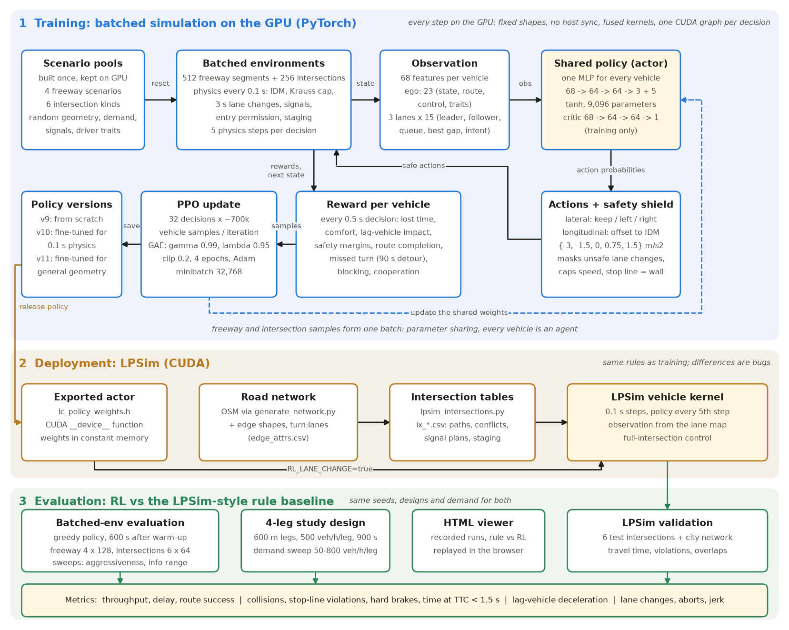
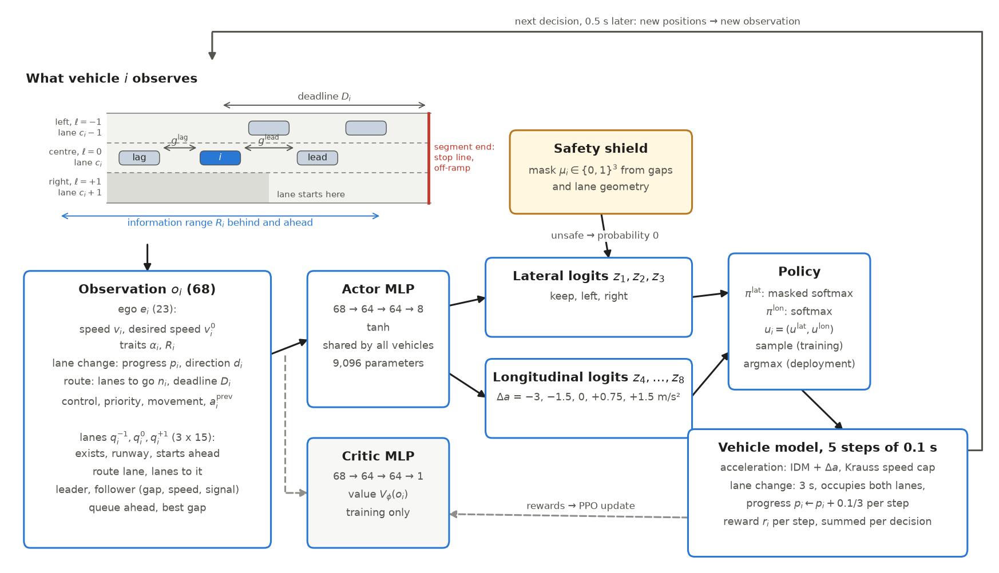

# RL lane-changing model for GPU traffic simulation — design

This document designs a reinforcement learning (RL) lane-changing model for traffic
simulation on the graphics processing unit (GPU), to the requirements in
[GPU-accelerated lane-changing model design.md](../GPU-accelerated%20lane-changing%20model%20design.md):
the model, how each requirement is met, training, test scenarios and metrics, and the
integration into LPSim (the Large-scale Parallel Simulator).

## 1. Overview

*Figure 1. Framework. (1) The policy is trained by Proximal Policy Optimization (PPO) in
batched simulations that run entirely on the GPU. (2) The trained actor is exported to
LPSim's vehicle kernel, which also runs the same intersection rules. (3) Both the batched
simulations and LPSim compare the policy with a rule baseline on the same metrics.
`tools/plot_framework.py` draws the figure.*

### 1.1 Overall structure

The model controls **lane changing** and adjusts **speed** around lane changes. Route
planning and driving through intersections stay rule-based. Figure 1 shows the three bands.

**Band 1: training,** entirely on the GPU.
- **Scenario pools** hold road designs generated once at start-up: freeway on-ramps,
  off-ramps, lane drops and lane additions, and six kinds of complete intersection, with
  randomised geometry, demand, signal timing and driver traits.
- **Batched environments** simulate many roads at once in PyTorch: 512 freeway segments
  (`lcrl/env.py`) and 256 complete intersections (`lcrl/ix_env.py`).
  - An intersection has every approach, the box and every exit, with curved and skewed
    legs, any number of lanes and multiple turn lanes.
  - Vehicles follow the intelligent driver model (IDM) for car following, and inside the
    box the right-of-way rules of [INTERSECTIONS.md](INTERSECTIONS.md).
  - Physics runs every 0.1 s. When a road's episode ends, it is *reset* with a new design
    from the pools ("reset" arrow).
- **Observation.** Every 0.5 s (a *decision*), each vehicle on a link observes 68 features
  of itself and of its own and adjacent lanes.
- **Shared policy.** Every vehicle runs the same multilayer perceptron (MLP),
  68 → 64 → 64 → 8 (section 4.1), which gives the probabilities of a lateral and a
  longitudinal action.
- **Safety shield.** Rules outside the network forbid lane changes into physically unsafe
  gaps and cap speed at a collision-free value. Only safe actions reach the environments,
  so the network learns *which* safe option is best, not how to avoid crashing.
- **Reward.** The environments run five physics steps and return each vehicle's reward and
  next state.
- **PPO update.** PPO updates the shared weights from these samples (dashed arrow) and saves
  each policy version (section 1.3).

**Band 2: deployment.** The released actor is exported as a CUDA (NVIDIA's Compute Unified
Device Architecture) `__device__` function with its weights in constant memory. LPSim's
vehicle kernel calls it for every vehicle at every decision when `RL_LANE_CHANGE=true`.
`tools/lpsim_intersections.py` generates the intersection tables of an OpenStreetMap (OSM)
network with the same code as the training environment, so LPSim runs the same
intersection rules ([LPSIM_INTEGRATION.md](LPSIM_INTEGRATION.md)).

**Band 3: evaluation.** The policy is compared with a rule baseline, on the same metrics
(section 1.4), in the batched environments, on the 4-leg study design, in the HyperText
Markup Language (HTML) viewer that replays recorded runs in a browser, and on LPSim test
networks.

### 1.2 Reinforcement learning formulation

Each vehicle is an agent. All agents share one policy and decide together every 0.5 s
(section 2).
- **Observation** (section 3): 68 features. 23 describe the vehicle: speed, driver traits,
  lane-change state, route and the control ahead. 15 describe each of the left, current and
  right lanes: leader, follower, queue and the best gap within the driver's information
  range.
- **Actions** (section 4): a lateral action (keep, left, right) and a longitudinal
  acceleration offset added to IDM. The shield masks unsafe lane changes.
- **Reward** (section 5): lost time, comfort, the impact on the new follower, safety margins
  (time to collision (TTC), hard braking), route completion, blocking a queue, and a
  cooperative share of the other vehicles' reward.
- **Driver types:** aggressiveness and information range are policy inputs, so one network
  covers every driver.

### 1.3 Training scheme

- **Algorithm:** PPO with an actor-critic network and generalised advantage estimation
  (GAE), section 6.1.
- **Data:** each iteration collects 32 decisions on all 512 freeway segments and 256
  intersections, about 700k vehicle decisions. Freeway and intersection samples form one
  batch.
- **Domain randomisation:** every episode draws a new road from the pools, and every
  vehicle draws its traits; 12% of vehicles are slow trucks.
- **Vehicle lengths:** cars are 5 m (`EnvConfig.veh_len`) and trucks 12 m
  (`EnvConfig.truck_len`), in `lcrl/config.py`. Positions are front bumpers and gaps are
  bumper to bumper. v12 was trained before trucks had their own length; v13 is v12
  fine-tuned with them.
- **Release lineage:** v11, trained in three stages, then v12. Each later stage starts from
  the previous stage's weights (`--init`):

  | Version | What it was trained for | Iterations, learning rate |
  |---|---|---|
  | v9 (`runs/ppo_v9_ix`) | freeway and complete intersections, from scratch | 500, 5e-4 |
  | v10 (`runs/ppo_v10_dt01`) | 0.1 s physics with 0.5 s decisions | 400, 3e-4 |
  | v11 (`runs/ppo_v11_geom`) | general geometry: curves, multi-lane turns, staged permitted turns | 400, 3e-4 |
  | v12 (`runs/ppo_v12_prep`) | distances on a 2 km log scale, freeway segments up to 2 km, weaving sections, preparation distance in the reward | 400, 3e-4 |
  | v13 (`runs/ppo_v13_len`), **not released** | vehicle lengths: 12 m trucks, per-vehicle lengths in every gap (section 9.1) | 400, 3e-4 |

  v11 took 53 minutes on an RTX 2080 Ti (about 8 s per iteration), before the speed-ups of
  section 1.5; v12 took 18 minutes (2.7 s per iteration), and so did v13. v13 was not better
  than v12 (section 9.1), so v12 stays the release, and LPSim runs v12.

### 1.4 Evaluation methods

Every evaluation compares the policy with a **rule baseline** (`rule_action` in
`lcrl/env.py`). The baseline is LPSim-style:
- it changes toward the route lane as soon as the shield allows;
- it changes lanes discretionarily when it is held up by a close leader (lead gap under
  50 m) and an adjacent lane that serves its route has a longer gap. "Held up" means
  either the leader is more than 2 m/s slower, or the vehicle drives below 80% of its
  desired speed $v_i^0$ (section 2.1);
- it uses pure IDM, with no speed offset.

The 80% condition was added so the baseline is a fair comparison. The earlier rule used
only the speed difference, so it never left a slow queue: in a queue the leader drives as
slowly as the vehicle itself. This mattered most in LPSim, which puts every entering
vehicle in the right lane. Training-env results, old rule / new rule / v12
(`runs/ppo_v12_prep/eval_rule2.md`):

| Case | Delay (s/veh) | Route success (%) |
|---|---|---|
| All freeway scenarios | 17.1 / 15.7 / 4.0 | 99.28 / 99.59 / 99.83 |
| 4-leg study design, 500 veh/h per leg | 28.6 / 25.8 / 10.8 | 99.70 / 99.73 / 99.93 |

The new rule changes lanes more often (1.04 instead of 0.40 lane changes per vehicle on
the freeway) and gains little delay. RL still cuts delay by about three quarters.

Both run on the same seeds, roads, demand and signal timing, and the policy acts greedily
(the most likely action).

The same rule also runs in LPSim (`rl::ruleAct` in
`external/LPSim/src/simulator/rl_lpsim.cuh`), selected with `LPSIM_RL=rule` (section 8).
It then uses the RL code path, so only the decision differs. LPSim's own lane-change
rule is a third, separate baseline.

- **Batched-environment evaluation** (`lcrl/evaluate.py`). Each of the 4 freeway
  scenarios runs on 128 segments and each of the 6 intersection kinds on 64 intersections,
  for 600 s after a 100 s warm-up. Optional sweeps fix every driver's aggressiveness
  (0.1, 0.9) or information range (50 m, 200 m).
- **Study design.** The 4-leg signal study design (600 m legs, permitted turns, right turn
  on red) at 500 veh/h per leg for 900 s, plus a demand sweep from 50 to 800 veh/h per leg.
- **LPSim validation.** The exported policy runs inside LPSim on single-intersection test
  networks of every control type and on a city network. Measures: travel time,
  completed trips, stop-line violations, conflict-zone overlaps and occupancy-list
  overflows.
- **Metrics** (section 7.4): throughput, delay against free flow, route success,
  collisions, stop-line violations, hard brakes, time with TTC below 1.5 s, the
  deceleration forced on the new follower, lane changes, aborts and root-mean-square (RMS)
  jerk.
- **Visual checks.** `lcrl/visualize.py` records rule and RL runs into a self-contained
  web page for side-by-side replay.

### 1.5 Time step and GPU execution

Running every computation on the GPU is the project's main design requirement.

- **Two time scales.** Vehicle kinematics and every rule run at a physics step of 0.1 s;
  the policy decides every 0.5 s, so one decision spans 5 physics steps.
  - The lateral action applies at the first step; the acceleration offset is held for the
    whole decision.
  - Rewards are summed over the 5 steps, with rate terms scaled so that a decision's reward
    has the same size as with a 0.5 s step.
  - LPSim does the same: `TIME_STEP=0.1`, with the policy evaluated every 5th step.
- **No central processing unit (CPU) work inside a step.** Fixed-shape tensor operations
  update all roads in a batch together: kinematics, rules, observations, policy sampling,
  spawning and resets. The CPU never waits for the GPU inside a step
  (`tests/test_graph.py`); training reads back statistics once per iteration.
- **Episode resets.** Each road slot simulates one road for an *episode*: 500 s for a
  freeway segment, 400 s for an intersection. At its end the remaining vehicles are removed
  and the slot gets a new road from the pools kept on the GPU. The reset is a masked write
  that leaves other slots untouched, so no synchronisation is needed.
- **Four speed measures** keep the finer step affordable without changing the simulation
  results (measurements in section 9.2):
  1. **CUDA graphs** (`lcrl/graph.py`). A decision is thousands of small GPU kernels, and
     launching them one by one from Python costs more than running them. One decision is
     recorded once and replayed with a single launch.
  2. **A smaller conflict rule.** Entry permission checks only the vehicles that could
     enter (at most 48 per intersection) against all vehicles, instead of all against all.
  3. **Kernel fusion** (`lcrl/fuse.py`). `torch.compile` compiles the rule functions into
     fewer, larger kernels that keep intermediate values in registers instead of GPU memory.
  4. **Neighbour search on sorted lane lists** (`lcrl/neighbours.py`). A hand-written CUDA
     kernel finds leaders, followers, queues and gaps among nearby vehicles in each lane
     only, instead of comparing every vehicle with every other.

  Measures 3 and 4 fall back to plain PyTorch when their compiler is unavailable, or with
  `LCRL_FUSE=0` and `LCRL_NB_KERNEL=0` (requirements in the README's Setup).

### 1.6 Requirement → mechanism

| Requirement | How it is produced |
|---|---|
| Executable on GPU | Everything runs on the GPU: the training env, the rules, spawning, resets and PPO, with no host synchronisation inside a step. Decisions run as CUDA graphs of fused kernels, with a hand-written neighbour-search kernel (section 1.5). Inference is a CUDA `__device__` function (`cuda/lc_policy.cuh`), checked against PyTorch (`tests/test_cuda_parity.py`). |
| RL model performs lane changes | PPO-trained shared policy, section 1.2. |
| Cancel if conditions no longer allow | 3 s lateral manoeuvre. It can be aborted once continuing becomes unsafe; the policy decides whether to abort or continue. |
| Discretionary: bypass slow vehicle, even leaving desired lane | 12% slow trucks. The efficiency reward, plus the per-lane "lanes to OK lane" and deadline features, let the policy weigh overtaking against the distance left to return. |
| Discretionary: join a shorter queue | Per-lane queue count and speed within the info range. Shared turn lanes and signals create unequal queues. |
| Proactive: toward turning / ramp lane | Route-need and deadline features. Lane-starts-ahead feature for bays and deceleration lanes. The missed-route penalty. |
| Proactive: make room for others (e.g. move to centre lane at an on-ramp) | Neighbour intent and urgency features, plus the cooperative reward share. |
| Mandatory cut-in | Lane-drop, acceleration-lane and turn-bay geometry. The lane-end wall forces the vehicle to merge before the end. |
| Find safe gaps; speed up / slow down to reach one | Best-gap size and position within range. Longitudinal action head. Shield guarantees the gap taken is safe. |
| Minimise impact on lag vehicle | Lag-impact penalty and hard-brake penalty. Measured as "decel forced on lag vehicle". |
| Avoid collisions | Shield (section 4). Zero collisions in all evaluations. |
| Help others: slow down for / speed up to make a gap | Longitudinal head, plus intent features of adjacent leaders and followers, plus the cooperative reward. |
| *Optional* aggressiveness levels | `aggr` ∈ [0,1] is an input and also scales reward weights and IDM headway. Set per vehicle at run time. |
| *Optional* information levels | `info_range` ∈ [50, 200] m is an input and also limits what is observed. Set per vehicle at run time. |
| *Optional* simple structure | 2×64 MLP, 9,096 actor parameters. |
| *Not required* route planning | Missed movements end the trip with a penalty. Re-routing is left to the planner. |

## 2. Reinforcement learning problem formulation

This section states lane changing as a multi-agent RL problem. Sections 3–6 give the
observation, the actions and shield, the reward and the learning algorithm, with the
equations the code implements (`lcrl/env.py` and `lcrl/ix_env.py` for the environment,
`lcrl/policy.py` and `lcrl/train.py` for the policy and its training). Figure 2 shows the
model for one vehicle.

*Figure 2. The RL model for one vehicle $i$. Top left: what it observes on its road: the
lane it is in (its centre lane $c_i$) and the lanes on either side, its leader and follower
with their gaps, the distance $D_i$ left to its deadline, and how far it perceives other
vehicles (its information range $R_i$), all defined in section 3. The actor's 8 outputs
split into a lateral head (masked by the safety shield) and a longitudinal head. The chosen
pair of actions drives the vehicle for five 0.1 s steps, giving the next observation and
the reward. The critic is used only in training.
`tools/plot_rl_model.py` draws the figure.*

### 2.1 Agents, time and the learning objective

**Agents.** Every vehicle on a road link is an agent, indexed by $i$. Let
$\mathcal{A}_t^e$ be the set of agents on road $e$ (one freeway segment or one intersection)
at decision $t$. Vehicles enter and leave all the time, so the set changes. Inside an
intersection box, vehicles follow the right-of-way rules and are not agents.

**Driver traits.** Each vehicle gets three fixed traits when it enters:
- **aggressiveness** $\alpha_i \in [0, 1]$, drawn uniformly. It sets the vehicle's time
  headway in car following (section 4.2), how much it values its own lost time and how
  polite it is to others (section 5.1);
- **information range** $R_i \in [50, 200]$ m, drawn uniformly: how far ahead and behind
  the driver perceives other vehicles (section 3);
- **desired speed** $v_i^0$: for cars $\bar v\,(0.9 + 0.2\,\xi)(0.95 + 0.1\,\alpha_i)$
  with $\xi$ uniform on $[0, 1]$ and $\bar v$ the speed limit; 12% of vehicles are slow
  trucks with $v_i^0 = (0.55 + 0.2\,\xi)\,\bar v$.

**Time** (section 1.5). Decisions are $\Delta = 0.5$ s apart and physics steps
$\delta = 0.1$ s, so a decision spans $n = \Delta/\delta = 5$ steps, indexed
$\tau = 1, \dots, n$.

**Partially observed Markov game.** The problem is a game
$\langle \mathcal{S}, \mathcal{O}, \mathcal{U}, P, r, \gamma \rangle$ with:
- a state $s_t \in \mathcal{S}$: every vehicle's position, speed, lane, lane-change
  progress, route and traits, plus the road geometry and the signal state;
- a private observation $o_t^i = O(s_t, i) \in \mathbb{R}^{68}$ for each agent;
- a joint action $u_t = (u_t^i)_{i \in \mathcal{A}_t}$, with $u_t^i \in \mathcal{U}$;
- stochastic transitions $P(s_{t+1} \mid s_t, u_t)$, from random arrivals, driver traits and
  signal offsets;
- a reward $r_t^i$ for each agent;
- a discount factor $\gamma = 0.99$ per decision.

**One shared policy.** All agents use the same stochastic policy $\pi_\theta(u \mid o)$
(*parameter sharing*). Training maximises the expected discounted return of an agent,
averaged over all agents, roads and driver types:

$$
J(\theta) = \mathbb{E}_{\pi_\theta}\Big[\sum_{t=t_0^i}^{t_1^i} \gamma^{\,t - t_0^i}\, r_t^i\Big],
$$

where $t_0^i$ is the decision at which vehicle $i$ enters and $t_1^i$ the one at which its
trip ends (section 5.1). The traits $\alpha_i$ and $R_i$ are policy inputs, so the policy
is conditioned on the driver type.

### 2.2 Why this structure

| Choice | Reason |
|---|---|
| One shared policy for all vehicles | Scales to any number of vehicles. Every simulated vehicle produces training data. |
| Driver traits (aggressiveness, information range) as **inputs** | One network covers every driver type. No retraining per type (optional requirements 1–2). |
| Discrete actions | Cheap argmax at inference. Easy to mask with the safety shield. Stable PPO. |
| RL adds to IDM instead of replacing it | Keeps LPSim's calibrated car following. RL only needs to learn deviations: opening or closing gaps, yielding. |
| Safety shield outside the network | Guarantees "avoid collisions" by construction, independent of training quality. |
| Lane change lasts 3 s and occupies both lanes | Makes "cancel if conditions change" meaningful. Neighbours see the vehicle in both lanes and react. |
| 68 → 64 → 64 → 8 MLP, tanh | Smallest network that learned the task. Weights fit in CUDA constant memory (36 KB). About 9.0k multiply-adds per vehicle (optional requirement 3). |
| Train in a purpose-built batched env, not inside LPSim | LPSim's existing RL hook re-runs the whole binary per episode via comma-separated values (CSV) files. Per-vehicle, per-step RL needs millions of decisions per second, which the batched env provides. It uses the same time step, IDM and lane conventions. |

## 3. Observation (68 features, all normalised to about [-1, 1])

The observation is a fixed-size vector made of 23 ego features and 15 features for each of
three lanes: left ($\ell = -1$), centre ($\ell = 0$) and right ($\ell = +1$) of the
vehicle's centre lane $c_i$:

$$
o_t^i = \big[\, e_t^i,\; q_t^{i,-1},\; q_t^{i,0},\; q_t^{i,+1} \,\big] \in \mathbb{R}^{23 + 3 \times 15}.
$$

**Lanes and the centre lane $c_i$.** The lanes of a road are numbered
$k = 0, 1, \dots, K - 1$ from the leftmost lane: $K = 6$ lane slots in the freeway env and
$K = 8$ at an intersection approach. A slot can be absent over part of the road (a turn bay
that starts late, an acceleration lane that ends) or over all of it. $c_i$ is a lane number:
the lane vehicle $i$ is counted in.
- Outside a lane change, $c_i$ is the lane it drives in.
- During a change from lane $k^{\text{from}}$ to $k^{\text{to}}$, the vehicle occupies both
  lanes, and $c_i$ is $k^{\text{from}}$ until the change is half done, then $k^{\text{to}}$.

The three observed lanes are lanes $c_i - 1$, $c_i$ and $c_i + 1$, named by their position
relative to the vehicle. In LPSim, $c_i$ is the lane number on the vehicle's current edge.

**Other symbols.**
- $x_i$, $v_i$: position along the road (m from its start) and speed; $v_i^0$, $\alpha_i$,
  $R_i$: the driver traits of section 2.1; $\bar v$: the speed limit; $L$: the length of the
  road (the freeway segment, or the approach link).
- $d_i \in \{-1, 0, +1\}$: direction of the lane change in progress (left, none, right).
- $p_i \in [0, 1)$: **lane-change progress**, the fraction of the 3 s change already done.
  It is 0 outside a change, gains $\delta / 3$ per physics step (30 steps in all), and
  returns to 0 when it reaches 1 and the vehicle is only in the target lane. An abort turns
  the vehicle back towards its origin lane and sets $p_i \leftarrow 1 - p_i$, the part of
  the way it has to go back.
- $m_i$: the vehicle's **next movement** from its route: left, through or right at an
  intersection, or through / exit on a freeway segment. A lane *serves* $m_i$ if it reaches
  the end of the road and allows that movement there.
- $n_i(k)$: the signed number of lanes from lane $k$ to the nearest lane that serves $m_i$:
  negative to the left, positive to the right, 0 if lane $k$ serves it (on a tie, the lane on
  the left). $n_i = n_i(c_i)$ is how many lane changes the vehicle still needs, and in which
  direction.
- $D_i$: the **deadline**, the distance from $x_i$ to the last point at which the vehicle can
  still be in its lane: the end of its centre lane or the end of the road, whichever comes
  first. For a vehicle that must change lanes, it is the distance left to do so.
- $a_i^{\text{prev}}$: the acceleration the vehicle achieved in the previous physics step.
- $\operatorname{clip}_{[a,b]}$: clipping to $[a, b]$.

**Ego features $e_t^i$ (23):**

| Feature | Definition |
|---|---|
| speed, desired speed | $v_i / \bar v$, $\;v_i^0 / \bar v$ |
| traits | $\alpha_i$, $\;R_i / 200$ |
| lane-change state | progress $p_i$; direction $d_i$ |
| route need | $\operatorname{clip}_{[-3,3]}(n_i)/3$ |
| deadline | $\psi(D_i)$, with the distance scale $\psi$ below |
| distance to the road end | $\psi(L - x_i)$ |
| control category | one-hot over 6: free, signal, all-way stop, two-way stop major, two-way stop minor, yield minor |
| priority at the stop line | $\varpi_i / 2$; blocked $b_i$; $\operatorname{clip}_{[0,1]}(t_i^{\text{sw}}/60)$; stopped $s_i$ (defined below) |
| next movement | one-hot of $m_i$ over left, through, right (or exit) |
| previous acceleration | $a_i^{\text{prev}} / 3$ |

**Priority at the stop line** (4 features): the vehicle's right to enter the intersection
with its next movement, from the rules of [INTERSECTIONS.md](INTERSECTIONS.md). The first
is the **priority rank** $\varpi_i$ of its movement:

| $\varpi_i$ | When |
|---|---|
| 2 | it has priority: green for its movement, a through or right movement on the major street of a two-way stop or yield, or a free road |
| 1.5 | a left turn from the major street (it yields only to opposing through traffic) |
| 1 | it may go after yielding: a permitted turn on green, the minor street after stopping, an all-way stop after stopping, the minor approach of a yield |
| 0.5 | a right turn on red after a full stop |
| 0 | it may not go: red, or a stop sign it has not yet stopped at |

The other three:
- **blocked** $b_i \in \{0, 1\}$: 1 when it has not been granted entry and either
  $\varpi_i = 0$ or it is first in line and the current gap in the conflicting traffic is too
  small;
- $t_i^{\text{sw}}$: the seconds until its signal indication changes (0 without a signal);
- **stopped** $s_i \in \{0, 1\}$: 1 once it has come to a stop at the line, which stop signs
  require.

On a road without a stop line, $\varpi_i = 2$ and $b_i = t_i^{\text{sw}} = s_i = 0$.

**Lane features $q_t^{i,\ell}$ (15 per lane, for lane $k = c_i + \ell$).** Let
$g_i^{\text{lead}}(k)$ and $g_i^{\text{lag}}(k)$ be the bumper-to-bumper gaps to the
nearest vehicle ahead and behind in lane $k$, and $v_{\text{lead}}$, $v_{\text{lag}}$ their
speeds. A vehicle changing lanes counts in both of its lanes.

The **information range** $R_i$ limits what the driver perceives. A neighbour beyond it is
reported as absent, with its gap set to the range: $\tilde g = g$ if $g < R_i$, otherwise
$\tilde g = R_i$. The queue count and the best-gap search below only consider vehicles
within the range.

| Feature | Definition |
|---|---|
| lane exists, runway, starts ahead | $\mathbb{1}[k \text{ exists at } x_i]$; $\psi(x^{\text{end}}_k - x_i)$; $\psi(x^{\text{start}}_k - x_i)$, where lane $k$ exists from $x^{\text{start}}_k$ to $x^{\text{end}}_k$ |
| route lane, lanes to it | $\mathbb{1}[k \text{ serves } m_i]$; $\min(\lvert n_i(k)\rvert, 3)/3$ |
| leader | $\operatorname{clip}_{[-5,200]}(\tilde g^{\text{lead}})/200$; $(v_{\text{lead}} - v_i)/10$; the leader's signal urgency $u$ if it signals into lane $c_i$, else 0 |
| follower | $\operatorname{clip}_{[-5,200]}(\tilde g^{\text{lag}})/200$; $(v_{\text{lag}} - v_i)/10$; the follower's signal urgency $u$ if it signals into lane $c_i$, else 0 |
| queue ahead | $M_i(k)/10$; mean speed $\bar v_i(k)/\bar v$ of those vehicles (1 if there are none) |
| best gap | $\min(G_i^\ast(k), 200)/100$; $\operatorname{clip}_{[-200,200]}(\Delta_i^\ast(k))/200$ |

**Turn signals.** The signal urgency tells a vehicle that a neighbour needs to cut into its
lane. A vehicle $j$ signals towards lane $c_j + \operatorname{sign}(n_j)$ when its route
needs a change, or towards its target lane while changing, with an urgency that grows near
its deadline:

$$
u_j = 1 \ \text{while changing lanes}, \qquad
u_j = \operatorname{clip}_{[0.1,1]}\big(1 - D_j/300\big) \ \text{otherwise}.
$$

**Queue ahead.** $M_i(k)$ counts the vehicles in lane $k$ ahead of $i$ and within its range:

$$
M_i(k) = \big|\{\, j \in k : 0 < x_j - x_i < R_i \,\}\big|.
$$

**Best gap.** $G_i^\ast(k)$ is the largest gap in front of any vehicle $j$ within range in
lane $k$, each gap capped at that vehicle's own range $R_j$:

$$
G_i^\ast(k) = \max_{j \in k,\; |x_j - x_i| < R_i} \min\!\big(g_j^{\text{lead}}(k),\, R_j\big),
\qquad
\Delta_i^\ast(k) = (x_{j^\ast} - x_i) + \tfrac12 G_i^\ast(k).
$$

Here $j^\ast$ is the vehicle behind the best gap, and $\Delta_i^\ast$ is the position of the
gap's centre relative to $i$. If no gap is non-negative, $G^\ast = R_i$ and
$\Delta^\ast = 0$.

**Distance scale $\psi$.** Every input must lie in about $[-1, 1]$, so distances go through

$$
\psi(d) = \min\!\Big(1,\ \frac{\log(1 + d/50\,\text{m})}{\log(1 + 2000/50)}\Big),
$$

which maps 50, 300, 600, 1,000 and 2,000 m to 0.19, 0.52, 0.69, 0.82 and 1. The logarithm
keeps metre-level detail near the deadline and still tells 400 m from 1,500 m. It is not a
decision threshold: when to change lanes is learned. (Up to v11, distances were divided by
300 m or 600 m, so nothing beyond 600 m was visible.) The turn-signal urgency still uses
300 m.

**Measured timing of route lane changes.** Within its preparation distance $H_i$
(section 5.1), a driver outside the route lanes pays a cost. The table gives the share of
exiting vehicles on the freeway off-ramp scenario that are at most one lane from their
route lane, by distance to the deadline. The route lane (the deceleration lane) exists only
in the last 150–300 m. Every driver has the same aggressiveness in each row (96 roads,
250 s).

| Policy | 0–100 m | 100–200 m | 200–500 m | 500–1,000 m | 1,000–2,000 m |
|---|---|---|---|---|---|
| Rule baseline | 96.8% | 93.6% | 90.5% | 85.3% | 75.6% |
| v12, $\alpha = 0$ (cautious) | 99.9% | 94.0% | 92.8% | 82.5% | 63.6% |
| v12, $\alpha = 0.5$ | 99.9% | 94.9% | 95.5% | 89.3% | 73.8% |
| v12, $\alpha = 1$ (aggressive) | 99.8% | 96.5% | 94.4% | 89.7% | 76.4% |

v12 does not yet show the intended pattern; cautious drivers are, if anything, slightly
later. Two reasons:
- **Nothing rewards staying left.** The right lanes are not slower on the training roads,
  so moving right early costs an aggressive driver nothing, and every driver moves early,
  as the rule does.
- **Cautious drivers change lanes less readily.** The lane-change cost $w_{lc}(1.5 - \alpha_i)$
  and politeness $\rho_i$ (section 5.1) are larger for them, so they wait for larger gaps.

v11, without the preparation term, behaved the same. Section 10 lists the next steps.

## 4. Actions and the safety shield

### 4.1 Actions and the policy

**Actions.** Each agent chooses a pair $u^i = (u^{\text{lat}}, u^{\text{lon}})$ from

$$
\mathcal{U} = \{\text{keep}, \text{left}, \text{right}\} \times \{-3,\, -1.5,\, 0,\, +0.75,\, +1.5\}\ \text{m/s}^2.
$$

- **Lateral:** keep (or continue the current change), change left, change right. Choosing
  the opposite direction during a change aborts it.
- **Longitudinal:** an acceleration offset $\Delta a(u^{\text{lon}})$, added to IDM and held
  for the whole decision.

**Why these five acceleration offsets.** The offset lets a vehicle open a gap for a merging
vehicle, drop back to a gap in the next lane, or speed up to merge ahead. The levels were
set by design, not tuned:
- **More braking than acceleration.** Yielding and dropping back need firmer action than
  IDM's own comfortable braking ($b = 2$ m/s²), while speeding up is limited by the vehicle:
  IDM gives at most $a_{\max} = 1.5$ m/s², and the total is capped at
  $a_{\max} + 1.5 = 3$ m/s².
- **−3 m/s²** is firm but not emergency braking. It stays below the shield's limit for the
  braking a lane change may impose ($b_{\text{lc}} = 4$ m/s²), the hard-braking penalty
  threshold (−4 m/s²) and the strongest braking ($b_{\max} = 6$ m/s²).
- **−1.5 m/s²** is gentle slowing, to let a gap arrive.
- **0** leaves plain IDM car following, the most common choice.
- **+0.75 and +1.5 m/s²** add half and all of $a_{\max}$ again.

Five levels keep the output small and the deployment argmax cheap while expressing "yield
firmly, yield gently, follow, speed up gently, speed up". Finer levels and a continuous
(Gaussian) offset have not been tried.

**Network.** The actor is an MLP that maps the observation $o$ to 8 scores (logits)
$z = (z_1, \dots, z_8)$:

$$
h_1 = \tanh(W_1 o + b_1),\quad h_2 = \tanh(W_2 h_1 + b_2),\quad z = W_3 h_2 + b_3,
$$

with $W_1 \in \mathbb{R}^{64 \times 68}$, $W_2 \in \mathbb{R}^{64 \times 64}$ and
$W_3 \in \mathbb{R}^{8 \times 64}$: 9,096 parameters. The critic $V_\phi(o)$ has the same
shape with one output, and is used only in training.

**Masked, factorised policy.** The 8 logits are split into two heads:
- $z_1, z_2, z_3$ score the lateral actions keep, left and right;
- $z_4, \dots, z_8$ score the five acceleration offsets, from −3 to +1.5 m/s².

With the actions numbered $u^{\text{lat}} \in \{1, 2, 3\}$ and
$u^{\text{lon}} \in \{1, \dots, 5\}$, the chosen actions have logits $z_{u^{\text{lat}}}$
and $z_{3+u^{\text{lon}}}$.

*Factorised:* the probability of an action pair is the product of one softmax per head, so
the two choices are drawn independently given the observation, and the network needs
3 + 5 = 8 outputs instead of 3 × 5 = 15. The choices are still coordinated through the
shared observation and hidden layers ("change left" and "speed up" can both become likely
when a gap opens ahead on the left).

*Masked:* the shield gives a mask $\mu^i \in \{0, 1\}^3$, with $\mu_k = 1$ when lateral
action $k$ is allowed (section 4.2). Forbidden actions get probability zero, and the rest
are renormalised:

$$
\pi_\theta(u \mid o, \mu) =
\underbrace{\frac{\mu_{u^{\text{lat}}}\, e^{z_{u^{\text{lat}}}}}{\sum_{k=1}^{3} \mu_k\, e^{z_k}}}_{\pi^{\text{lat}}}
\;\cdot\;
\underbrace{\frac{e^{z_{3+u^{\text{lon}}}}}{\sum_{m=1}^{5} e^{z_{3+m}}}}_{\pi^{\text{lon}}},
\qquad
\log \pi_\theta = \log \pi^{\text{lat}} + \log \pi^{\text{lon}}.
$$

"Keep" is always allowed, so the denominator is never zero. The code sets forbidden logits
to $-10^9$, which gives the same distribution: a forbidden action is never sampled, and
training never moves probability towards it. Training samples from $\pi_\theta$;
evaluation and deployment take the most likely allowed action of each head.

### 4.2 Vehicle kinematics and the safety shield

At each physics step $\tau$, every vehicle's acceleration comes from IDM plus the agent's
offset. A safe-speed cap and the braking limit then bound it.

**IDM.** For a gap $s$ to a leader and a closing speed $\Delta v = v - v_{\text{lead}}$:

$$
a_{\text{IDM}}(v, s, \Delta v) = a_{\max}\Big[1 - \Big(\frac{v}{v^0}\Big)^{4} - \Big(\frac{s^\ast}{s}\Big)^{2}\Big],
\qquad
s^\ast = s_0 + \max\!\Big(0,\; vT_i + \frac{v\,\Delta v}{2\sqrt{a_{\max} b}}\Big),
$$

with $a_{\max} = 1.5$ m/s², $b = 2$ m/s², $s_0 = 1.38$ m, and a headway
$T_i = 1.2\,(1.3 - 0.6\,\alpha_i)$ s that shrinks with aggressiveness. The free-road term
uses $s \to \infty$.

The vehicle takes the minimum of $a_{\text{IDM}}$ over:
- the leaders in every lane it occupies (both lanes during a change);
- the end of its lane;
- the stop line, while its movement is blocked and it is not committed.

**Krauss safe speed.** For the same obstacles, with leader speed $v_l$ (0 for a wall),
$\hat b = 4.5$ m/s² and a 0.5 m margin, the speed cap is

$$
v^{\text{safe}}(v, s, v_l) = v_l + \frac{s - 0.5 - v_l\,\delta}{(v + v_l)/(2\hat b) + \delta},
\qquad
v^{\text{cap}} = \min_{\text{obstacles}} v^{\text{safe}}.
$$

**Speed and position update.** With $b_{\max} = 6$ m/s² the strongest braking:

$$
\begin{aligned}
a &= \max\!\Big(-b_{\max},\ \min\!\big(\operatorname{clip}_{[-b_{\max},\, a_{\max}+1.5]}(a_{\text{IDM}} + \Delta a),\ (v^{\text{cap}} - v)/\delta\big)\Big),\\
v' &= \min\!\big(\max(0,\, v + a\,\delta),\ 1.15\,\bar v\big),\qquad
x' = x + \tfrac12 (v + v')\,\delta .
\end{aligned}
$$

On curved intersection links $v^0$ is also capped by the curve speed (INTERSECTIONS.md
section 1).

**Lane changes.** A change lasts 3 s and occupies both lanes throughout:
$p' = p + \delta/3$, complete when $p' \ge 1$; an abort swaps the origin and target lanes and
sets $p \leftarrow 1 - p$ (section 3).

**Shield: when a lane change may start.** Lateral action "left" or "right" into lane $k$ is
allowed only if all of these hold:
- **geometry:** lane $k$ exists at $x_i$, continues for more than 15 m, and the link end or
  stop line is more than 10 m away;
- **the new leader** can be followed without braking harder than $b_{\text{lc}} = 4$ m/s²:
  $$
  g^{\text{lead}} \ge s_0 \quad\text{and}\quad \frac{v_i^2 - v_{\text{lead}}^2}{2\,b_{\text{lc}}} \le g^{\text{lead}} - s_0;
  $$
- **the new follower** does not have to brake harder than $b_{\text{lc}}$ either:
  $$
  g^{\text{lag}} \ge s_0 \quad\text{and}\quad \frac{v_{\text{lag}}^2 - v_i^2}{2\,b_{\text{lc}}} + v_{\text{lag}}\,\delta \le g^{\text{lag}} - s_0 .
  $$

During a change, continuing is always allowed. Aborting is allowed only once the target lane
fails this test. If two vehicles start into the same lane side by side in the same step,
only the one in front proceeds.

**Shield: stop line (amber logic).** An uncommitted vehicle treats a blocked stop line as a
wall. A vehicle becomes *committed*, and may clear even if the signal or conflict state then
changes, once its movement is allowed (green, or an accepted stop or yield gap) and it
can no longer stop comfortably or is close to the line:

$$
s^{\text{stop}} - s_0 < \frac{v^2}{2 \times 3.5} \quad\text{or}\quad s^{\text{stop}} < 10\ \text{m}.
$$

At intersections, entry into the box is then decided by the right-of-way and gap-acceptance
rules of [INTERSECTIONS.md](INTERSECTIONS.md); the agent does not choose it.

### 4.3 Design history of the shield

- **Stop-line commitment.** An earlier shield exempted any vehicle that "could not stop
  comfortably"; PPO then sped up towards red lights (41% of signal crossings on red).
  Crossing while uncommitted is now a counted violation with a −1 reward.
- **Aborts.** When the policy could abort at any time, stopped vehicles in LPSim's city
  queues started and reversed discretionary changes over and over (30% of lane changes
  aborted). The requirement asks to cancel when "the traffic conditions no longer allow"
  the change, so aborts are now a safety response only.
- **Safe versus comfortable.** The shield allows any *physically* safe gap; choosing one
  that is also *comfortable* for the follower is learned (section 5).

## 5. Reward (per vehicle, per decision)

### 5.1 Reward and termination

The reward is computed at every physics step and summed over the decision:
$r_t^i = \sum_{\tau=1}^{n} r_{t,\tau}^i$. Rate terms carry the factor $\kappa = \delta/0.5$,
so their weights are "per 0.5 s" whatever the physics step. Three driver-dependent factors
appear:
- the lost-time weight $(0.5 + \alpha_i)$: aggressive drivers value time more;
- politeness $\rho_i = 0.2 + 0.8\,(1 - \alpha_i)$;
- the **preparation distance** $H_i = 1000 - 800\,\alpha_i$ m (from 1,000 m for $\alpha_i = 0$
  to 200 m for $\alpha_i = 1$): how far before its deadline the driver wants to be in a route
  lane. Cautious drivers prepare early, aggressive drivers late.

**Own reward of vehicle $i$ at one physics step.** $a_i$ is the acceleration in the step and
$j_i = (a_i - a_i^{\text{prev}})/\delta$ the jerk. $\mathbb{1}^{\text{start}}_i$ and
$\mathbb{1}^{\text{abort}}_i$ are 1 in a step where $i$ starts or aborts a lane change; the
other indicators mark the events listed after the equation. The weights $w$ are in the
table below.

$$
\begin{aligned}
\hat r^{\,i} =\; & -w_e\,\kappa\,(0.5 + \alpha_i)\,\max\!\Big(0,\, 1 - \frac{v_i}{\max(v_i^0, 1)}\Big)
&& \text{lost time}\\
& - w_c\,\kappa\,\Big[\Big(\frac{a_i}{3}\Big)^2 + \Big(\frac{j_i}{10}\Big)^2\Big]
&& \text{comfort (jerk } j_i\text{)}\\
& - w_{lc}\,(1.5 - \alpha_i)\,\mathbb{1}^{\text{start}}_i - w_{ab}\,\mathbb{1}^{\text{abort}}_i
&& \text{manoeuvres}\\
& - w_{lag}\,\rho_i\, I_i
&& \text{impact on the new follower}\\
& - w_b\,\kappa\,\rho_i\, w_e\, Q_i\, \mathbb{1}^{\text{free}}_i
&& \text{blocking}\\
& - \kappa\,\big(w_{ttc}\,\mathbb{1}[\text{TTC}_i < 1.5\,\text{s}] + w_{hb}\,\mathbb{1}[a_i < -4]\big)
&& \text{safety margins}\\
& - w_p\,\kappa\,\min(|n_i|, 3)\,\mathbb{1}[D_i < H_i]
&& \text{preparation}\\
& + w_s\,\mathbb{1}^{\text{success}}_i + \big(w_m - w_e\,(0.5 + \alpha_i)\,\tfrac{90}{0.5}\big)\,\mathbb{1}^{\text{missed}}_i
&& \text{route}\\
& + w_{to}\,\mathbb{1}^{\text{timeout}}_i + w_{col}\,\mathbb{1}^{\text{collision}}_i + w_v\,\mathbb{1}^{\text{violation}}_i
&& \text{failures}
\end{aligned}
$$

with these terms:
- **Impact on the new follower** $f$ when $i$ starts a change: the acceleration $f$ loses,
  computed with IDM before and after the cut-in:
  $$
  I_i = \operatorname{clip}_{[0,6]}\big(a_{\text{IDM}}^{f}(\text{current leader}) - a_{\text{IDM}}^{f}(\text{leader } i)\big).
  $$
- **Queue held up** within 60 m behind, counting only slow vehicles ($v_j < 3$ m/s):
  $$
  Q_i = \sum_{j \text{ behind } i \text{ in lane } c_i,\; x_i - x_j < 60,\; v_j < 3} (0.5 + \alpha_j)\,\max\!\Big(0,\, 1 - \frac{v_j}{\max(v_j^0, 1)}\Big).
  $$
  The blocking term counts only when the road ahead is free:
  $\mathbb{1}^{\text{free}}_i = \mathbb{1}[g_i^{\text{lead}} > 15 + 1.5\,v_i \text{ and the link end is more than 15 m away}]$.
- **Time to collision:** $\text{TTC}_i = g^{\text{lead}} / (v_i - v_{\text{lead}})$, counted
  only when the vehicle is closing in, $v_i - v_{\text{lead}} > 0.1$ m/s.
- **Route events** happen at the end of a freeway segment (success: in a lane that serves
  the movement) or when crossing an intersection's stop line (success: entering the box on
  the intended movement). A *missed movement* pays a flat penalty plus a 90 s detour at the
  driver's own lost-time rate.
- **Violation:** leaving a freeway segment through a blocked, uncommitted stop line, or
  entering an intersection box without being granted entry.

**Cooperative reward.** Each agent also receives a share of the mean own reward of all
agents on its road, larger for polite drivers:

$$
r_{t,\tau}^i = \hat r^{\,i} + \eta\,(1 - \alpha_i)\,\frac{1}{|\mathcal{A}^e_\tau|}\sum_{j \in \mathcal{A}^e_\tau} \hat r^{\,j},
\qquad \eta = 0.5 .
$$

**Weights** (`RewardConfig`):

| $w_e$ | $w_c$ | $w_{lc}$ | $w_{ab}$ | $w_{lag}$ | $w_b$ | $w_{ttc}$ | $w_{hb}$ | $w_p$ | $w_s$ | $w_m$ | $w_{to}$ | $w_{col}$ | $w_v$ |
|---|---|---|---|---|---|---|---|---|---|---|---|---|---|
| 0.05 | 0.01 | 0.04 | 0.04 | 0.10 | 1 | 0.05 | 0.10 | 0.02 | 1 | −1 | −1 | −5 | −1 |

**Termination.** Agent $i$'s trip ends ($d_t^i = 1$) when, during the decision, it:
- leaves its road: the end of a freeway segment, or the end of an intersection's exit link;
- collides;
- exceeds the age limit (400 s on a freeway segment; 1,200 s at an intersection, longer than
  the 400 s intersection episode, so there it is only a deadlock guard);
- is on a road that is reset at the end of an episode (section 1.5).

Training treats all of these as terminal. Empty vehicle slots and vehicles inside an
intersection box (not agents) produce no sample; the advantage recursion (section 6.1)
restarts after such a decision.

### 5.2 Purpose of each term

Weights are per 0.5 s, as in section 5.1.

| Term | Purpose |
|---|---|
| `−0.05·(0.5+aggr)·(1 − v/v_des)` | efficiency, as a lost-time penalty; aggressive drivers value speed more. It must never be positive: an earlier `+v/v_des` bonus taught vehicles to creep at the stop line (yield-sign delay 35 s vs 5 s for the baseline). |
| `−0.01·[(a/3)² + (jerk/10)²]` | comfort |
| `−0.04·(1.5−aggr)` per lane change started, `−0.04` per abort | no unnecessary manoeuvres |
| `−0.10·politeness·Δa_lag` | **impact on the lag vehicle**: the acceleration the new follower loses (as in MOBIL, Minimizing Overall Braking Induced by Lane changes). |
| `−0.05` if TTC < 1.5 s, `−0.10` if a < −4 m/s² | safety margins |
| `−0.02` per lane still to go, within the preparation distance $H$ of the deadline | **preparation**: when the driver starts looking for a gap to its route lane. It is meant to make the timing depend on the driver: cautious drivers (H up to 1 km) move early, aggressive ones (H down to 200 m) stay in faster lanes until late, pushed by their larger lost-time weight. v12 does not achieve this yet; its timing is still about the same for every driver (section 3, section 10). |
| `+1` reached the end in a lane serving its movement, `−1` timeout, `−5` collision, `−1` stop-line violation | route completion |
| missed movement: `−1 − 0.05·(0.5+aggr)·(90 s / 0.5 s)` | a missed turn is handed to the route planner (out of scope), priced as a 90 s detour at the driver's own lost-time rate. A flat `−2` was cheaper than waiting for a permitted left, and the policy skipped turns (88.6% route success at intersections). |
| `−0.05·politeness·(lost-time rate of the queue held up within 60 m)` while the road ahead is free and the vehicle is not at a stop line | **blocking**. A vehicle pays its own detour cost but otherwise only a diluted share of the delay it causes the queue behind it, so the detour-priced policy would stop in a through lane to wait for a gap into a full turn bay. On its own the term did not remove the throughput loss at heavy 4-leg signals: v9 already had it (section 10). |
| `+0.5·(1−aggr)·mean reward of all vehicles on the segment` | **cooperation**: polite drivers gain when others merge, exit or turn successfully, which drives yielding and making gaps. |

## 6. Training plan

### 6.1 Learning algorithm

The policy is trained with PPO, using the clipped objective and GAE.

**Rollouts.** Each iteration collects $H = 32$ decisions in all roads at once. Every
$(i, t)$ with $i \in \mathcal{A}_t$ is one sample. The critic gives $V_\phi(o_t^i)$, and
the value after the last decision is used to bootstrap.

**Advantages.** With temporal-difference errors

$$
\delta_t^i = r_t^i + \gamma\,(1 - d_t^i)\,V_\phi(o_{t+1}^i) - V_\phi(o_t^i),
$$

the advantages and value targets are

$$
\hat A_t^i = \sum_{l \ge 0} (\gamma\lambda)^l \Big(\prod_{m=0}^{l-1} (1 - d_{t+m}^i)\Big)\, \delta_{t+l}^i,
\qquad
\hat R_t^i = \hat A_t^i + V_\phi(o_t^i),
$$

with $\gamma = 0.99$ and $\lambda = 0.95$. The recursion is also cut at a decision with no
sample (section 5.1). The advantages are normalised to zero mean and unit variance in each
minibatch.

**Loss.** With the probability ratio
$\varrho_t^i(\theta) = \pi_\theta(u_t^i \mid o_t^i, \mu_t^i) / \pi_{\theta_{\text{old}}}(u_t^i \mid o_t^i, \mu_t^i)$:

$$
\mathcal{L}(\theta, \phi) =
-\,\mathbb{E}\Big[\min\big(\varrho\,\hat A,\ \operatorname{clip}(\varrho, 1 - \epsilon, 1 + \epsilon)\,\hat A\big)\Big]
+ c_v\,\mathbb{E}\Big[\tfrac12\big(V_\phi(o) - \hat R\big)^2\Big]
- c_H\,\mathbb{E}\big[\mathcal{H}(\pi^{\text{lat}}) + \mathcal{H}(\pi^{\text{lon}})\big],
$$

with $\epsilon = 0.2$, $c_v = 0.5$ and $c_H = 0.01$. $\mathcal{H}$ is the entropy of a head,
$\mathcal{H}(\pi) = -\sum_k \pi_k \log \pi_k$; its bonus keeps the policy exploring. Each
iteration runs 4 epochs over the rollout in minibatches of 32,768 samples. The optimiser is
Adam ($\epsilon_{\text{Adam}} = 10^{-5}$), with the learning rate decaying linearly to zero
over the run and the gradient norm clipped at 0.5.

**Parameter sharing.** Every sample, freeway or intersection, updates the same $\theta$ in
one pooled batch. The policy stays decentralised: each vehicle acts only on its own
observation, which is what LPSim needs at deployment.

### 6.2 Plan and status

1. **Validate the environment with the rule baseline** of section 1.4 (done): zero
   collisions and sensible throughput and delays in the five freeway scenarios and the six
   intersection kinds
   (`tests/test_env.py`). The full-intersection env had zero collisions, violations and
   deadlocks over more than 100k trips.
2. **PPO with domain randomisation** (done). The current release is v12
   (`runs/ppo_v12_prep`; lineage and current training setup in section 1.3). The settings
   below are those of the first freeway-only release, v4 (`runs/ppo_v4`):
   - Setup: 1024 segments × 64 vehicle slots; scenario type, geometry, demand, signal timing, driver traits and truck share are randomised per segment or vehicle.
   - PPO settings: 32-step rollouts, γ = 0.99, λ = 0.95, clip 0.2, 4 epochs, minibatch 32 768, learning rate 5e-4 decaying linearly, 400 iterations.
   - Cost: about 2 s per iteration (about 550k agent-steps), about 14 minutes in total on an RTX 2080 Ti.
   - Command: `python -m lcrl.train --iterations 400 --lr 5e-4 --minibatch 32768 --out runs/ppo_v4`.
3. **Robustness** (next). Mix rule-driven vehicles into training so the policy does not
   rely on all neighbours being cooperative. Add higher demand levels and longer segments.
   Add adversarial aggressiveness mixes.
4. **LPSim integration and validation** (section 8): the exported policy against LPSim's
   built-in rules on the scenario networks and a city network, with the metrics of
   section 7.4.
5. **Calibration** (next). Fit the reward weights and trait distributions so that
   lane-change rates, accepted gaps and lane-change durations match trajectory data (Next
   Generation Simulation (NGSIM), highD, pNEUMA). Optionally add a behaviour-cloning term
   during fine-tuning.

## 7. Test scenarios, intersection geometry and metrics

### 7.1 Test scenarios

`lcrl/scenarios.py` generates all required scenarios, plus a weaving section, with
randomised geometry and demand. Segments that end at a deadline are up to 2 km long, so
that vehicles learn to prepare from far away. The four single-leg intersection rows were
later replaced by complete intersections (`lcrl/ix_env.py`, kinds `signal_4leg`,
`signal_tee`, `all_way_stop`, `two_way_stop_4leg`, `two_way_stop_tee` and `yield_4leg`),
each with every approach, the box, every exit and optional pedestrians; they remain the
scenarios of the v4 results in section 9.3.

| Scenario | Geometry |
|---|---|
| Freeway on-ramp | 0.6–1.2 km, 2–4 lanes + acceleration lane (150–300 m) that ends. Ramp demand 290–1080 veh/h. |
| Freeway off-ramp | 0.6–2 km, 2–4 lanes + deceleration lane (last 150–300 m). 15–40 % of vehicles exit; they know it from the segment entry. |
| Freeway lane drop | 0.6–2 km; rightmost lane ends 150–300 m before the segment end |
| Freeway lane addition | 0.6–1.2 km; new right lane starts 100–250 m into the segment |
| Freeway weaving section | an on-ramp at 100–200 m joined to the off-ramp at the segment end by an auxiliary lane, 300–900 m of weaving. 10–30 % of mainline vehicles exit (they must enter the auxiliary lane); 10–30 % of ramp vehicles exit too, the rest must leave the auxiliary lane to the left. |
| Signal, dedicated turn lanes | 1–3 through lanes + left bay (50–120 m) + right bay (40–90 m). Protected left phase. |
| Signal, shared turn lanes | 2–3 lanes, leftmost shared left/through, rightmost through/right |
| Stop sign | shared lanes. Each vehicle must stop, then wait for a gap in the conflicting stream. |
| Yield sign | shared lanes. Vehicles proceed if the conflicting stream is clear, otherwise stop. |

### 7.2 How intersection geometry is stored

*Figure 3. (a) The stored geometry of the 4-leg signal study design, drawn from its arrays
(the centre ± 75 m of its 600 m legs). (b) How the arrays are organised and indexed.
Regenerate with `python tools/plot_geometry_schematic.py`.*

`lcrl.intersection.build` turns a list of legs into one **design**: a dictionary of numpy
arrays. Every array is padded to fixed sizes: 4 leg slots, K = 8 lanes per leg, P = 48
turning paths and up to 12 signal phases. All designs can therefore be stacked into one GPU
tensor per field, the *design pool* (`lcrl.intersection.stack`). Each environment `e` keeps
only an index `design_idx[e]` into that pool, and `IntersectionEnv.D(key)` gathers a field
for every environment at once.

| Group | Arrays (shape) | Content |
|---|---|---|
| Links | `L_app`, `L_exit`, `n_in`, `n_out` (leg) | Each leg has an approach link (ids 0–3) and an exit link (ids 4–7), with any number of lanes. |
| | `centrelines` (leg) | The leg's centre-line polyline from the intersection centre outward (`Centreline`): curves, from OSM edge shapes. It is used only when designs are built and drawn; the simulation stays one-dimensional along links. |
| | `D` (leg), `angle` (leg) | The per-leg setback from the centre to the stop line, and the leg's direction at the box. |
| | `vcap_app`, `vcap_exit` (leg, 241) | Curve speed caps every 5 m along each link (99 = no curve). |
| Lanes | `lane_start`, `lane_end` (leg, lane) | Where the lane exists along its link, in metres. A bay is a lane with `lane_start > 0`: the 45 m right bay of the study design runs from 555 to 600 m. Several lanes may serve the same turn (dual or triple turn lanes). |
| | `lane_mov`, `lane_exit` (leg, lane) | Bitmasks of the movements (left / through / right) and the exit legs the lane serves. |
| Turning paths | `p_pts` (P, 48, 2), `p_s` (P, 48), `p_len` (P) | One path per (approach lane, exit leg): a cubic Bézier centreline through the box, sampled at 48 points, with the arc length at each sample. |
| | `p_leg`, `p_lane`, `p_exit`, `p_exit_lane`, `p_mov` (P) | Where each path starts and ends, and its movement. |
| | `path_of` (leg, lane, movement) | Lookup from a vehicle's lane and next movement to its path; −1 if the lane does not serve that movement. |
| Conflicts | `c_kind`, `c_in`, `c_out` (P, P) | Precomputed wherever two path centrelines come within 2.6 m. `c_kind` is none / crossing / merge / diverge; `c_in[p, q]` … `c_out[p, q]` is the conflict zone on path p, in metres along p. |
| Signal plan | `phase_dur` (phase), `phase_state` (phase, P) | The duration of each phase, and each path's state in it: red, permitted, green or amber. |
| Staging | `s_wait` (P), `n_stage` (P) | For permitted turns: where to wait inside the box (just before the first zone shared with same-phase green traffic), and how many vehicles fit there (≤ 2). |

**Vehicles have no 2D position.** Vehicle state is a set of `[E, N]` tensors:

| Field | Meaning |
|---|---|
| `link` | 0–3 on an approach, 4–7 on an exit, −1 inside the box |
| `staged` | A permitted turner waiting inside the box for a gap |
| `lane_from`, `lane_to`, `prog` | The current lane, or a lane change in progress and how far it has got |
| `x` | Metres along the link, or along the vehicle's path inside the box |
| `mov` | The vehicle's next movement |
| `path` | Its path once it has entered the box |

World coordinates are computed only for the viewer: `lcrl.visualize_ix.world_xy` places
vehicles along the centre lines, and `draw_primitives` turns the same centre lines into road
polygons, so the viewer draws any geometry.

### 7.3 How an approaching vehicle decides whether a gap is safe

Entry permission is a rule, `IntersectionEnv._permission`, run at every physics step and
identical for the rule baseline and the RL policy. Only the head vehicle of each approach
lane, or a staged vehicle, can be granted entry, so the rule pairs those candidates (at
most 48 per intersection) with every vehicle: `[E, 48, N]` tensors for all intersections at
once.

1. **Intended path.** `_plan` looks up each vehicle's path, `path_of[link, current lane, mov]`.
   This includes oncoming and crossing vehicles.
2. **Conflict.** `c_kind[plan_i, plan_j]` tells whether vehicles i and j conflict. An oncoming
   through vehicle conflicts with a permitted left turn because their paths cross in the
   precomputed table.
3. **Position on the path.** `_participant_s` places every vehicle on its own path; a negative
   value is the distance still to go to its stop line. Vehicle j's distance to the conflict
   zone is `c_in[plan_j, plan_i] − s_j`.
4. **Arrival time.** `_t_reach_capped` predicts when j arrives. It accelerates at `a_max` up to
   its desired speed, then cruises.
5. **Priority.** `_rank` sets each vehicle's rank from its path's signal state: green 2,
   permitted 1, right turn on red 0.5. Stop and yield control have their own ranks
   ([INTERSECTIONS.md](INTERSECTIONS.md) section 2).
6. **Decision.** Vehicle i is refused entry if any higher-rank conflicting vehicle j within
   250 m of its stop line arrives sooner than both of:
   - the critical gap of i's movement: left 4.0 s, through 5.5 s, right 5.0 s, plus up to
     1 s for cautious drivers (`1 − aggressiveness`);
   - i's own time to clear the conflict zone, plus a post-encroachment margin of 1 s.
7. **Staging.** If a permitted turner has no gap, it may pull past the stop bar and wait at
   its path's staging point, then re-check from there at every step. Once its phase ends it
   has priority to clear. The exact rules, and the deadlocks they prevent, are in
   [INTERSECTIONS.md](INTERSECTIONS.md) section 3.

   Vehicles already inside the box, or already granted entry, are checked separately against
   their actual occupancy of the conflict zone. Entry also needs free crosswalks and room on
   the exit lane.

**Assumptions and limitations.**

- **Perfect information.** The rule reads the exact position, speed and true intended path
  of every vehicle. There are no sight lines, occlusion or estimation error, and an oncoming
  vehicle's turn is known exactly rather than inferred from its turn signal.
- **Fixed look-ahead.** The 250 m range is a constant. The per-driver information range
  (50–200 m) applies only to the lane observations.
- **The policy does not choose the gap.** The RL observation covers the ego's own lane and the
  lanes either side on its own link, plus its rank, whether it is blocked and the time until
  the signal changes. It contains no oncoming traffic. The policy shapes the approach (lane
  and speed); the go/no-go is the rule's.
- **LPSim runs the same rule with bounded lists.** `kernel_ixPublish` writes each vehicle
  near a controlled node into lists for its path:
  - a *near* list (up to 16 entries) for vehicles in the box, committed to it, or within 80 m;
  - a *far* list (up to 16 entries) for vehicles approaching 80–250 m out, used only for the
    higher-priority gap check.

  A vehicle then reads only the lists of the paths that conflict with its own
  (`ix_lpsim.cuh`). The near list is never displaced by distant vehicles. A full list is
  counted as an overflow. There were none in the single-intersection test networks; the city
  network has millions (section 10).

### 7.4 Metrics and evaluation

Metrics (`lcrl/evaluate.py`), per scenario:

| Group | Metrics |
|---|---|
| Efficiency | throughput (veh/h), delay vs. free flow (s/veh) |
| Route | route success (% of vehicles in a lane serving their movement at the end) |
| Safety | collisions per 1000 vehicles; stop-line violations (%); hard brakes (a < −4 m/s²) per vehicle; time with TTC < 1.5 s per vehicle |
| Impact on others | the new lag vehicle's actual maximum deceleration in the 2 s after each cut-in |
| Manoeuvres | lane changes per vehicle, aborted lane changes per vehicle |
| Comfort | RMS jerk |

Evaluation settings (greedy policy, segments per scenario, durations and trait sweeps) are
in section 1.4.

## 8. Integration into LPSim

Built and tested; see [LPSIM_INTEGRATION.md](LPSIM_INTEGRATION.md). In short:
- LPSim gets the full-intersection control of [INTERSECTIONS.md](INTERSECTIONS.md), with
  designs generated per node from OSM tags by the same Python builder the training env uses.
- The policy runs in LPSim's vehicle kernel with the 68 training observations, built from
  the lane map plus a turn-indicator map, and with the trained action semantics: 3 s lane
  changes that occupy two lanes, safety-only aborts, and the acceleration offset with a
  Krauss cap.
- The policy's segment in LPSim runs along the vehicle's path through every node where all
  lanes continue, up to the next lane choice, controlled intersection or 2 km. Its deadline,
  lane runways, route lanes and neighbour search are measured along it, as on a training
  segment.
- LPSim edges can have lanes that start or end part-way (turn bays, acceleration and
  deceleration lanes) and lane links at nodes, generated from OSM lane counts and turn-lane
  tags (`generate_network.py --lane-spans`).
- **Three lane-change modes,** set by `LPSIM_RL` in `tools/wsl_run_lpsim.sh`:
  - unset: LPSim's own lane-change rule;
  - `LPSIM_RL=1`: the RL policy (`RL_LANE_CHANGE=true`);
  - `LPSIM_RL=rule`: the training env's rule baseline (section 1.4, `rl::ruleAct`). The
    script sets `RL_LANE_CHANGE=true` and the environment variable `LPSIM_LC_RULE=1`. The
    rule then runs on the same code path as RL (route-aware segment, observation, safety
    shield, lane-change motion, give-up rule); only the decision differs.
- **Same fleet in every mode.** Driver traits (aggressiveness, information range, desired
  speed factor, slow trucks, vehicle length) are drawn for every vehicle in every mode
  (`rl::initTraits`). Before, they were drawn only in RL mode, so under LPSim's rule every
  vehicle drove at the speed limit.
- **Vehicle lengths.** Each vehicle has a length `vehicle.vlen`: cars 5 m, trucks 12 m
  (`rl::kCarLen`, `rl::kTruckLen`). A length byte per lane-map cell, `lg::View::lenMap` in
  `lane_geo.cuh`, sits beside the lane map and is written at every lane-map write. Every
  leader gap, LPSim's own gap acceptance (`calculateGapsLC`), the RL neighbour scans and
  the intersection occupancy entries (`Occ.len` in `ix_lpsim.cuh`) use the real lengths, so
  all gaps are bumper to bumper. The IDM jam distance is the true $s_0 = 1.38$ m in all run
  scripts (before, $s_0 = 6.38$ m hid a 5 m length in it).
- **Policy work only on decision steps.** The route-aware segment and the observation are
  built only every 0.5 s. Between decisions the vehicle holds its deadline (reduced by the
  distance driven) and its lanes-to-go (`vehicle.rlDeadline`, `vehicle.rlNeed`). During a
  lane change it scans only the other lane's leader (`rl::leadInLane`). Traffic results did
  not change; timing in section 9.2.
- **Bugs fixed in `cuda_traffic_sim.cu`:**
  - a vehicle whose move was undone (its target cell was taken) was not written into the
    lane map that step, so its followers drove into it (`lgStayVisible`);
  - the gap to a leader on the next edge counted only the distance into the next edge, not
    what was left of the current edge.
- All source changes are in `tools/patches/lpsim.patch`.

## 9. Results

### 9.1 Release model

Results of the release model v11 (`runs/ppo_v11_geom`) are in the
[README](../README.md#results-release-model-runsppo_v11_geom-greedy-policy-01-s-physics):
- freeway scenarios and every intersection kind, against the rule baseline;
- the 4-leg study design;
- LPSim test networks.

**v12** (`runs/ppo_v12_prep`, fine-tuned from v11; section 1.3) against the rule baseline,
greedy policy, 96 roads per freeway scenario over 600 s after a 100 s warm-up, and 32 copies
of the study design over 1,200 s after 300 s (`runs/ppo_v12_prep/eval_v12.py`):

| Scenario | Delay (s/veh) | Route success (%) | Throughput (veh/h) | Collisions |
|---|---|---|---|---|
| Freeway on-ramp | 17.0 → 2.7 | 100 → 100 | 3,536 → 3,655 | 0 → 0 |
| Freeway off-ramp (up to 2 km) | 13.8 → 2.9 | 98.66 → 99.97 | 2,897 → 2,907 | 0 → 0 |
| Freeway lane drop (up to 2 km) | 44.2 → 10.6 | 100 → 100 | 2,789 → 3,178 | 0 → 0 |
| Freeway lane addition | 7.5 → 0.9 | 100 → 100 | 3,083 → 3,082 | 0 → 0 |
| Freeway weaving section (new) | 6.4 → 3.1 | 97.79 → 99.21 | 3,347 → 3,334 | 0 → 0 |
| 4-leg signal study design, 500 veh/h/leg | 28.6 → 10.8 | 99.70 → 99.93 | 2,009 → 2,010 | 0 → 0 |

This table uses the earlier rule baseline. With the fairer rule of section 1.4, the rule's
delay drops to 15.7 s/veh on all freeway scenarios and 25.8 s/veh on the study design;
v12 stays at 4.0 and 10.8 s/veh.

In LPSim (section 8) v12 matches v11 on the freeway ramp network (median travel time
107 s) and misses fewer turns at the 4-leg signal with bays (0.13% vs 0.55%). Its timing
of route lane changes does not yet depend on aggressiveness (section 3).

**v13 with vehicle lengths (not released).** v13 (`runs/ppo_v13_len`) is v12 fine-tuned
for 400 iterations (18 minutes) with 12 m trucks and per-vehicle lengths in every gap
(section 1.3). In the training env (`lcrl/env.py`, `lcrl/ix_env.py`), each vehicle has a
length `vlen`:
- `_bumper_gaps` subtracts the leader's length from the gap ahead and the vehicle's own
  length from the gap behind;
- collisions, spawn room, conflict-zone clearance and exit room use the per-vehicle
  lengths;
- the observation is unchanged, since its gaps were already bumper gaps.

Evaluated with lengths, rule / v12 / v13 (`runs/ppo_v13_len/eval_v13.md`, new rule):

| Case | Delay (s/veh) | Route success (%) |
|---|---|---|
| All freeway scenarios | 16.6 / 4.3 / 4.9 | 99.54 / 99.87 / 99.85 |
| 4-leg study design, 500 veh/h per leg | 26.5 / 11.2 / 11.4 | 99.75 / 99.93 / 99.92 |

v12 copes with the 12 m trucks it was not trained on, and v13 is no better, in the env or
in LPSim (same or slightly worse). v12 stays the release.

**LPSim test networks with vehicle lengths** (`runs/lpsim_nets/time_rule_rl.sh`), LPSim's
rule / env rule (`LPSIM_RL=rule`) / v12:

| Network | Median trip time | Other result |
|---|---|---|
| Freeway with ramps | 266 / 140 / 107 s | all trips finished in every mode |
| 4-leg signal with 60 m left-turn bays | 83 / 82 / 72 s | missed turns 2.39 / 0.17 / 0.64% |

- On the freeway, LPSim's rule is much slower than in the earlier runs (171 s): slow
  trucks, desired-speed factors and vehicle lengths now apply to it too (section 8). The
  env rule leaves slow queues and closes most of the gap to v12.
- At the 4-leg signal, v12 is fastest but misses more turns than the env rule (section 10).

Section 9.3 keeps the earlier freeway-only model for reference.

### 9.2 Computation speed

These are measurements of the four speed measures of section 1.5. They were taken on an RTX
2080 Ti, per 0.5 s decision (5 physics steps, the next observation and the policy).

**CUDA graphs.** In eager mode, Python launches every kernel separately. On the freeway
batch, that costs about 28 µs of wall-clock time per kernel, while the average kernel runs
on the GPU for only 7 µs, so the GPU mostly waits. The CUDA graph removes the launch cost:

| Batch | Kernels | Mean kernel time | Eager | CUDA graph | Speed-up |
|---|---|---|---|---|---|
| 512 freeway segments (training) | ~5,300 | 7 µs | 149 ms | 35 ms | 4.3× |
| 256 intersections (training) | ~9,950 | 16 µs | 298 ms | 164 ms | 1.8× |
| 256 copies of the 4-leg study design (600 m legs, up to 224 vehicles) | ~9,900 | 29 µs | 345 ms | 295 ms | 1.2× |

Freeway kernels are tiny, so launching dominated and the graph gives most of the gain.
Intersection kernels do more work, so the GPU itself is the limit and the gain is smaller.
These measurements are without kernel fusion. The graph reproduces the eager simulation
exactly, bit for bit (`tests/test_graph.py`).

**Where the GPU time went.** Timing each function with CUDA events (eager mode) showed that
the neighbour search was about half the intersection environment's time. It compared every
vehicle with every other vehicle in every lane, building masks of shape `[E, N, N, K]`: for
the study design, 256 × 224 × 224 × 8 ≈ 100 million elements per mask, several per call, at
every 0.1 s step.

| Function (4-leg study design, 256 copies) | GPU time per decision |
|---|---|
| Neighbour tables, `_tables` | 162 ms |
| In-box walls, `_box_walls` | 50 ms |
| Entry permission, `_permission` | 31 ms |
| Collision check, `_collisions` | 27 ms |
| Spawning, `_spawn` | 13 ms |
| Everything else | under 4 ms each |

**Kernel fusion.** `torch.compile` (TorchInductor, which generates Triton kernels) compiles
the functions that only read the state: neighbour tables, entry permission, in-box walls,
collision check, lane geometry, lane-change masks, signal control and paths. Measured with
CUDA graphs on in both columns:

| Batch | Unfused | Fused | Speed-up |
|---|---|---|---|
| 512 freeway segments | 34.6 ms | 18.1 ms | 1.9× |
| 256 copies of the 4-leg study design | 293 ms | 69 ms | 4.3× |

- The neighbour tables alone went from 32 ms to 4.6 ms per call.
- Fused values differ from unfused ones only in the order of additions in sums (about
  1e-6). On the freeway on-ramp and the study design (500 veh/h/leg, rule and RL), every
  evaluation metric was identical with and without fusion.
- The first run compiles the kernels: about 30 s for the freeway environment and 70 s for
  the intersection environment. The kernels are then cached on disk.

**Neighbour search on sorted lane lists.** Each vehicle is entered into the list of every
lane it occupies (one list per (link, lane) at an intersection). The lists are sorted by
position with two stable GPU sorts. Then one CUDA thread per (road, vehicle, lane):
- binary-searches the vehicle's place in that lane's list;
- takes the neighbouring entries as leader and follower;
- scans only within the vehicle's information range for the queue and the best gap, and
  60 m behind for the queue it holds up.

Work per vehicle and lane drops from O(N) to O(log n + vehicles in range). Measured with
CUDA graphs:

| Batch | CUDA graph only | + fusion | + sorted-list kernel |
|---|---|---|---|
| 512 freeway segments (on-ramp) | 34.6 ms | 18.0 ms | 15.4 ms |
| 256 copies of the 4-leg study design | 293 ms | 74.9 ms | 48.8 ms |

- The two right-hand columns were measured in the same session; repeated runs vary by
  about 10%.
- The gain grows with the number of vehicles per road, because the dense search grows with
  its square.
- The kernel reproduces the dense search exactly, including its tie-breaking (smallest
  slot index first). Only the speed sum and queue cost differ, by at most 3e-5, from the
  order of additions (`tests/test_neighbours.py`).

Overall, a decision is about 6× faster than with CUDA graphs alone for the study design
(293 → 49 ms), and 2.2× faster for the freeway (34.6 → 15.4 ms).

**LPSim: policy work only on decision steps.** In LPSim the RL block used to build the
route-aware segment and the 68-feature observation at every 0.1 s step. It now builds them
only on decision steps (every 0.5 s); in between it holds the deadline and lanes-to-go,
and during a lane change it scans only the other lane's leader (section 8). Traffic
results did not change. Times are LPSim's own timer for the GPU simulation loop, measured
before vehicle lengths were added, LPSim's rule / RL before / RL after:

| Network | Rule | RL before | RL after |
|---|---|---|---|
| Freeway with ramps, 1.5 h | 11.3–13.2 s | 19.2–20.1 s | 12.4–13.0 s |
| 4-leg signal with bays | 12.8–13.9 s | 18.4–19.0 s | 15.0–15.7 s |
| San Francisco Bay Area city network (70,891 trips, 1 h simulated, 0.1 s step) | 79–84 s | 153 s | 130 s |

- Ranges are repeated runs (`runs/lpsim_nets/time_rule_rl.sh` for the test networks;
  `runs/lpsim_nets/city_bay_v12.txt` and `city_bay_v12_fast.txt` for the city).
- At city scale RL now costs 1.6× the rule's time, down from 1.8×. On the freeway it is
  about as fast as the rule.

### 9.3 Earlier model: `runs/ppo_v4`, greedy policy

128 segments per scenario, 600 s after a 100 s warm-up, mixed driver traits. Full tables
are in `runs/ppo_v4/eval.md`.

| Metric (all scenarios) | Rule baseline | RL (v4) |
|---|---|---|
| Throughput (veh/h per segment) | 2140 | **2250** (+5%) |
| Delay (s/veh) | 16.8 | **6.1** (−64%) |
| Route success (%) | 98.7 | 98.8 |
| Collisions / 1000 veh | 0 | 0 |
| Stop-line violations (%) | 0.0005 | 0.005 |
| Hard brakes (a < −4) / veh | 0.203 | **0.191** |
| Lag vehicle's max decel after cut-in (m/s²) | 1.83 | **1.65** |
| Lane changes / veh | 0.36 | 0.49 |
| Aborted lane changes / veh | 0 | 0.009 |
| Time with TTC < 1.5 s (s/veh) | 0.00001 | 0.0006 |
| RMS jerk (m/s³) | 0.82 | 1.25 |

| Scenario | Delay, rule → RL (s/veh) | Route success, rule → RL (%) |
|---|---|---|
| Freeway on-ramp | 12.7 → 2.7 | 100 → 100 |
| Freeway off-ramp | 5.5 → 0.7 | 96.8 → 96.8 |
| Freeway lane drop | 24.6 → 5.3 | 100 → 100 |
| Freeway lane addition | 5.2 → 0.6 | 100 → 100 |
| Signal, dedicated turn lanes | 42.1 → 22.3 | 95.3 → 95.7 |
| Signal, shared turn lanes | 63.8 → 31.8 | 96.0 → 97.6 |
| Stop sign | 14.3 → 5.5 | 98.8 → 99.0 |
| Yield sign | 5.2 → 0.8 | 98.7 → 98.5 |

Driver-trait sweeps. In each run *every* vehicle has the same trait value.

| Population | Delay | Lane changes / veh | TTC < 1.5 s (s/veh) | Hard brakes / veh |
|---|---|---|---|---|
| aggressiveness 0.1 | 7.6 | 0.41 | 0.00002 | 0.24 |
| aggressiveness 0.9 | 5.0 | 0.60 | 0.0032 | 0.17 |
| info range 50 m | 6.1 | 0.49 | 0.0002 | 0.19 |
| info range 200 m | 6.2 | 0.49 | 0.0013 | 0.19 |

How to read these results:
- **Aggressiveness works as intended.** Aggressive drivers change lanes about 50% more
  often, accept tighter situations, and lose less time.
- **Lag-vehicle braking is confounded in these sweeps.** In an all-polite population the
  followers also keep longer IDM headways, so they react more strongly to the same cut-in.
  Judge lag-vehicle braking from the mixed-population runs above.
- **The information range has almost no effect yet.** The policy does not make much use
  of long-range gap or queue information. More scenarios where long range matters (long
  queues, distant gaps) are needed before the information level is a meaningful setting.
- **Route misses are about the same for RL and the rule baseline,** and did not change
  when the miss penalty was doubled (`runs/ppo_v5`). This points to infeasible cases
  (dense traffic with short deceleration lanes or turn bays) rather than policy errors.
  That is not yet verified.
- **Cost of the gains.** RL drives more actively (higher jerk, more lane changes) and has
  slightly more short-TTC situations, all still very small in absolute terms.

Earlier runs, kept for reference:

| Run | What changed | Why it was rejected |
|---|---|---|
| v1, v2 | — | Exploited an amber-light loophole (see section 4) |
| v3 | — | Learned to linger because the efficiency reward was positive (see section 5) |
| v5 | missed-route penalty −4 | Same results as v4 |

## 10. Limitations and open items

What the current policy, v12 (`runs/ppo_v12_prep`), still does not do well. "The rule" is
the rule baseline (section 1.4) or, in LPSim, LPSim's own lane-change rule; "the env rule"
is the rule baseline run inside LPSim (`LPSIM_RL=rule`, section 8).

- **Turn completion vs. capacity under heavy demand (mostly resolved).** v9 completed 99.9%
  of turns on its heavy 4-leg signal test, but turning queues spilled out of the bays and
  throughput halved (2,700 → 1,270 veh/h, `runs/ppo_v9_ix/eval.md`).
  - The blocking cost (section 5.2, weight $w_b = 1$) was already in v9's reward (it is in
    v9's saved configuration), so the blocking cost alone did not remove the loss.
  - Since v10 the 4-leg signal test is the lighter study design, and RL no longer loses
    throughput there: 1,264 → 1,317 veh/h with v11, and 2,009 → 2,010 veh/h with v12 at
    500 veh/h per leg, with 99.93% route success (section 9.1). In LPSim, v12 finishes every
    trip at the 4-leg signal with bays and no longer loses capacity at city scale (next item).
  - Still open: no version after v9 was run on v9's oversaturated test, and the balance is
    still set by a fixed 90 s detour price for a missed turn. Next steps: a demand sweep up
    to 800 veh/h per leg on the study design, or route-planning cost from the network
    (rerouting in LPSim) instead of a fixed detour.
- **City scale in LPSim: capacity is now on par, missed movements are not.** On the San
  Francisco Bay Area network `sf_bay_area` (70,891 trips, 1 h, 0.1 s step, before vehicle
  lengths, `runs/lpsim_nets/city_bay_v12_envrule.txt`), LPSim's rule / env rule / v12:

  | Measure | LPSim's rule | Env rule | v12 |
  |---|---|---|---|
  | Trips departed in the first half hour that finished | 26.4% | 24.3% | 28.0% |
  | Mean speed (miles per hour) | 43.8 | 42.4 | 51.2 |
  | Missed movements | 3.18% | 4.25% | 3.67% |
  | Conflict-zone overlaps (of about 1.8 million crossings) | 9 | 0 | 43 |

  v9 moved 29% fewer vehicles through intersections than the rule; v12 does not. All three
  have zero stop-line violations. The remaining gap is that v12 misses slightly more
  movements than LPSim's rule and has more conflict-zone overlaps.
  - **Unexplained:** the env rule misses more movements than both LPSim's rule and v12 at
    city scale, although it misses the fewest on the 4-leg test network (next item).

  Candidate causes for v12, not yet separated:
  - distribution shift: the city has short, mostly single-lane edges, unlike training
    approaches of 150–250 m (the policy's segment runs on through plain nodes, so short
    edges in a row look like one longer segment);
  - the network has no lane spans or turn-lane tags (see below), so route lanes come from a
    heuristic;
  - the occupancy lists (16 entries per path) overflow: about 6.4 million near-list and
    5.1 million far-list overflows under v12, against 2.7 and 2.9 million under the rule.
    Vehicles that do not fit are invisible to the entry-permission check, which may explain
    some overlaps;
  - a lane change occupies two lanes for 3 s in LPSim's 1 m lane map.

  `LPSIM_RL_DUMP=1` dumps the policy's observations for such comparisons (used to find the
  `prev_accel` and abort issues). The city run has not been repeated with vehicle lengths.
- **RL misses more turns than the env rule on the 4-leg test network.** With vehicle
  lengths, at the 4-leg signal with 60 m left-turn bays, v12 misses 0.64% of turns, the env
  rule 0.17% and LPSim's rule 2.39% (section 9.1), although v12 is faster (median trip
  72 s against 82 s). The env rule changes toward the route lane as soon as the shield
  allows. Why v12 misses more is not yet investigated.
- **Real-network geometry needs OSM attributes.** `sf_bay_area`, used for the city run
  above, has no edge shapes, turn lanes or lane spans, so its legs are straight, lane use
  comes from a heuristic and every lane spans its whole edge. Regenerate it with
  `generate_network.py --lane-spans` to get curves, tagged turn lanes, turn bays and
  acceleration lanes.
- **Lane spans depend on OSM tagging.** Bays and auxiliary lanes are found only where OSM
  splits a way at the lane-count change; an untagged change is placed on the right, and bays
  shorter than 30 m are extended to 30 m.
- **Give-up rule in LPSim (partly addressed).** A vehicle stopped at its segment end outside
  its route lanes drives on after 30 s, missing its route. v12 now trains on weaving sections
  (an on-ramp joined to the next off-ramp by an auxiliary lane, 300–900 m long), where route
  success rose from 97.79% (rule) to 99.21%. Training still ends vehicles at an age limit
  (400 s on a freeway segment), though, and LPSim still needs the give-up rule; it has not
  been tested whether v12 resolves two vehicles waiting for each other's lane without it.
- **Planning distance does not yet depend on the driver.** v12 sees up to 2 km ahead, trains
  on 2 km segments and has the preparation term (section 5.1), but its timing of route lane
  changes still does not follow aggressiveness: 1–2 km before the exit, 63.6% of cautious
  ($\alpha = 0$) and 76.4% of aggressive ($\alpha = 1$) exiting vehicles are within one lane
  of their route lane (table and causes in section 3; the 12% slow trucks spawn in any
  lane). Options: let slow vehicles spawn in, and keep to, the right lanes; make the
  lane-change cost independent of aggressiveness; calibrate $H_i$ and the preparation
  weight $w_p$ from trajectory data.
- **One road element at a time.** Each training env is one segment or one intersection,
  so preparing for a turn two links ahead is not trained.
- **LPSim kinematics.** LPSim's default IDM parameters (maximum acceleration a = 0.56 m/s²)
  are much slower than the training kinematics; with them, stop-controlled intersections
  are capacity-starved. Parity runs set a = 1.5 m/s², comfortable deceleration b = 2.0 m/s²,
  time headway T = 1.2 s and jam distance s₀ = 1.38 m. Vehicle lengths are now modelled
  (section 8), so s₀ no longer has to hold a 5 m length (it was 6.38 m before).
- **Untested environment conditions.**
  - Unmodified LPSim crashes with an illegal memory access on `sf_tertiary_v2`; city runs
    use `sf_bay_area`.
  - LPSim intersection control and the RL lane changes run only on a single GPU.
- **Simplified intersection model.**
  - Lateral motion is a fixed-duration move; lateral speed is not an action.
  - Pedestrian demand is synthetic.
  - Signal timing is fixed-time (no actuation).
- **Reward weights** and trait distributions are hand-set and not yet calibrated to data
  (planned next step below).
- **The information range** barely changed behaviour when last measured (v4, section 9.3).
  Add scenarios where long-range gap and queue information pays off, and repeat the sweep
  with v12.
- **Vehicle lengths did not improve the policy.** v13, fine-tuned with 12 m trucks, was
  no better than v12 in the env or in LPSim (section 9.1).

**Planned next step: validation and calibration against real trajectory data.** Data sets:
NGSIM (Next Generation Simulation, United States freeway and arterial trajectories), highD
(German highway drone data), and exiD, inD and rounD (drone data at highway exits and
entries, intersections and roundabouts).
- **Two policies.** A human-calibrated policy for background traffic, and the current
  efficient policy for automated vehicles.
- **Step 1: calibrate the reward weights and the driver-trait distributions** (aggressiveness,
  information range, desired speed) by Bayesian optimisation, so that the simulated
  behaviour matches the data.
- **Step 2: imitation fine-tuning** on the observed trajectories, if gaps to the data remain
  after step 1.

**Resolved.**
- **v10 stalled in LPSim's 4-leg signal network** (fixed in v11). Granted vehicles sometimes
  chose the maximum braking offset at the stop line and stood still, and the rest of the
  junction then waited for them as committed traffic. Granted vehicles now commit: their
  offset cannot be negative, in the env and in LPSim. Together with the relaxed gap rule and
  staging, v11 finishes every trip in all LPSim test networks.
