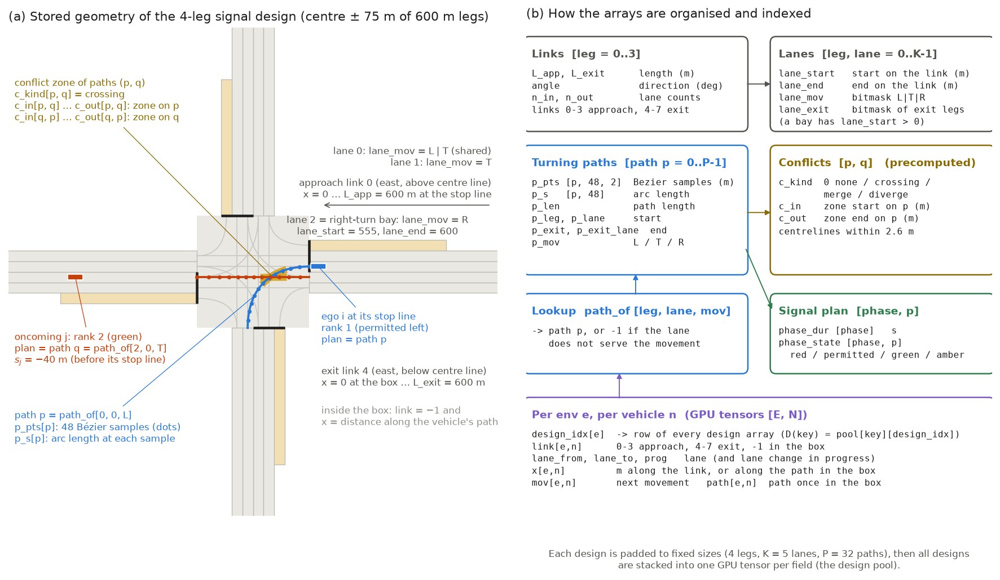

# RL lane-changing model for GPU traffic simulation — design

This document designs a reinforcement learning (RL) lane-changing model for traffic
simulation on the graphics processing unit (GPU). It implements the requirements in
[GPU-accelerated lane-changing model design.md](../GPU-accelerated%20lane-changing%20model%20design.md).
It covers the model structure, how each requirement is met, the training plan, the
test scenarios and metrics, and how the model plugs into LPSim (the Large-scale Parallel Simulator).

## 1. Approach in one paragraph

Every vehicle runs the same small neural policy (**parameter sharing**: one network,
millions of agents). Every 0.5 s (a *decision*) the policy sees a fixed-size, vehicle-centred
observation of its own lane and the two adjacent lanes, and outputs two discrete
actions: a **lateral** action (keep / left / right, where steering against an
ongoing change cancels it) and a **longitudinal** action (an acceleration offset added
to the Intelligent Driver Model (IDM) car-following acceleration LPSim already uses). A hard-coded **safety
shield** masks lane changes into physically unsafe gaps and caps acceleration at a
collision-free speed, so the network learns *which* safe option is best rather than
how to avoid crashing. The policy is trained with Proximal Policy Optimization (PPO) in a batched GPU environment
(thousands of road segments simulated in parallel in PyTorch). It is then exported
as a ~9k-parameter CUDA (NVIDIA's Compute Unified Device Architecture) `__device__` function that LPSim's vehicle kernel calls for
every vehicle at every decision.

Training uses two batched environments at once:
- **freeway segments** (`lcrl/env.py`: on-ramp, off-ramp, lane drop, lane addition);
- **complete intersections** (`lcrl/ix_env.py`): every approach, the box and every exit;
  4-leg and T layouts; signals with protected and permitted lefts, right turn on red,
  all-way and two-way stop, yield; pedestrians.

Inside the box, vehicles follow the rule-based right-of-way model specified in
[INTERSECTIONS.md](INTERSECTIONS.md); the policy acts on links. LPSim runs the same
intersection rules and the policy ([LPSIM_INTEGRATION.md](LPSIM_INTEGRATION.md)).

## 2. Time step and GPU execution

Running every computation on the GPU is the project's main design requirement. The physics
step is 0.1 s, five times finer than the earlier 0.5 s step, so each decision now costs
five times as much simulation. This section explains the two time scales, how the
simulation stays on the GPU, and the two changes that keep the finer step affordable.

### 2.1 Two time scales

Vehicle dynamics run at a physics step of **0.1 s** (`EnvConfig.dt`). The policy, and the
rule baseline, decide every **0.5 s** (`EnvConfig.decision_dt`), so one `env.step()` runs 5
physics steps.
- The lateral action applies on the first physics step; later steps continue a lane change
  already in progress.
- The acceleration offset is held for the whole decision. IDM, the Krauss safety cap,
  entry permission and every rule are re-evaluated at each 0.1 s step.
- Rewards are summed over the 5 steps. Terms that are rates (lost time, comfort, time to
  collision (TTC), hard braking, blocking) are scaled by `dt / 0.5 s`, so a decision's reward has the same size as
  with the earlier 0.5 s step.
- LPSim does the same: `TIME_STEP=0.1`, with the policy evaluated every 5th step.

### 2.2 No central processing unit (CPU) work while simulating

A training batch holds many independent **environment slots**: 512 freeway segments and
256 intersections. Every decision step updates all of them at once with the same fixed-shape
tensor operations, with no device-to-host synchronisation:
- observations, rules and dynamics;
- policy sampling;
- **spawning:** each slot's entry queues release vehicles into free vehicle slots. Free
  slots are found with a cumulative sum and filled with masked scatters, so no list of
  vehicles is ever built on the CPU;
- **episode resets** (below).

**What an episode reset is.** Each environment slot simulates one road for an *episode*:
300 s for a freeway segment, 400 s for an intersection (`episode_s`). When its episode
ends, the slot is *reset*:
- vehicles still on the road are removed, and their trajectories end there;
- the slot gets a new road, drawn at random from a **pool** generated once at start-up and
  kept on the GPU (256 freeway segments per scenario type, 64 intersection designs per
  kind). A road includes its geometry, lanes, demand, speed limit and signal offset;
- new vehicles then enter the empty road.

Resets give the policy a steady stream of different roads and traffic conditions. Episode
ends are staggered when training starts, so only a few slots reset at any step.

A reset is a **masked write**. Every slot computes `where(reset_mask, new_value, old_value)`,
so the slots that are not resetting are untouched. Python never has to ask the GPU which
slots ended, which would force the CPU to wait for the GPU (a synchronisation).

`tests/test_graph.py` fails if any step synchronises with the host. PPO reads back its
statistics once per iteration.

### 2.3 CUDA graphs: removing kernel-launch overhead

Each tensor operation in PyTorch runs as a separate GPU program, a *kernel*. The CPU
*launches* every kernel: Python and PyTorch prepare its arguments and the CUDA driver queues
it. One decision (5 physics steps, the next observation and the policy) launches thousands
of kernels. On the freeway batch below, eager mode spends about 28 µs of wall-clock time per
kernel, while the average kernel runs on the GPU for only 7 µs. The GPU then spends much of the time idle,
waiting for the CPU to launch the next kernel.

A *CUDA graph* records the whole sequence of kernels once and replays it with a single
launch, so the per-kernel CPU cost disappears. `lcrl/graph.py` captures one decision this
way.
- It reproduces the eager simulation exactly, bit for bit (`tests/test_graph.py`).
- Training, evaluation and the viewer all use it.

How much it helps depends on how much GPU work each kernel does. Measured on an RTX
2080 Ti, per 0.5 s decision (5 physics steps plus the policy):

| Batch | Kernels | Mean kernel time | Eager | CUDA graph | Speed-up |
|---|---|---|---|---|---|
| 512 freeway segments (training) | ~5,300 | 7 µs | 149 ms | 35 ms | 4.3× |
| 256 intersections (training) | ~9,950 | 16 µs | 298 ms | 164 ms | 1.8× |
| 256 copies of the 4-leg study design (600 m legs, up to 224 vehicles) | ~9,900 | 29 µs | 345 ms | 295 ms | 1.2× |

Freeway kernels are tiny, so launching dominates and the graph gives most of the gain.
Intersection kernels do more work (the neighbour search compares every vehicle with every
other vehicle), so the GPU itself is the limit and the gain is smaller. Section 2.5 reduces
that GPU work. (These measurements are without kernel fusion.)

### 2.4 Keeping the conflict rule small

Entry permission ([INTERSECTIONS.md](INTERSECTIONS.md) section 3) runs at every 0.1 s step. Only a vehicle about to enter can be granted entry: the head
vehicle of each approach lane, or a vehicle waiting inside the box (staged). The rule
therefore checks at most 48 of these candidates per intersection against every vehicle,
`[E, 48, N]` pairs, instead of every vehicle against every vehicle, `[E, N, N]` (N = 160 vehicle slots in
training): less than a third as many pairs.

## 3. Why this structure

| Choice | Reason |
|---|---|
| One shared policy for all vehicles | Scales to any number of vehicles. Every simulated vehicle produces training data. |
| Driver traits (aggressiveness, information range) as **inputs** | One network covers every driver type. No retraining per type (optional requirements 1–2). |
| Discrete actions | Cheap argmax at inference. Easy to mask with the safety shield. Stable PPO. |
| RL adds to IDM instead of replacing it | Keeps LPSim's calibrated car following. RL only needs to learn deviations: opening or closing gaps, yielding. |
| Safety shield outside the network | Guarantees "avoid collisions" by construction, independent of training quality. |
| Lane change lasts 3 s and occupies both lanes | Makes "cancel if conditions change" meaningful. Neighbours see the vehicle in both lanes and react. |
| 68 → 64 → 64 → 8 multilayer perceptron (MLP), tanh | Smallest network that learned the task. Weights fit in CUDA constant memory (36 KB). About 8.5k multiply-adds per vehicle (optional requirement 3). |
| Train in a purpose-built batched env, not inside LPSim | LPSim's existing RL hook re-runs the whole binary per episode via comma-separated values (CSV) files. Per-vehicle, per-step RL needs millions of decisions per second, which the batched env provides. It uses the same time step, IDM and lane conventions. |

## 4. Observation (68 features, all normalised to about [-1, 1])

**Ego (23 features).**
- Own state: speed / limit, desired speed / limit, aggressiveness, information range.
- Lane-change state: lane-change progress, lane-change direction.
- Route: route need (signed lanes to the nearest lane that serves the next movement), distance to where that must be done, distance to segment end.
- Control: control category one-hot (free / signal / all-way stop / two-way-stop major / two-way-stop minor / yield minor), own movement's right-of-way rank, "my movement is blocked", time to signal change, "already stopped at the stop line".
- Next movement one-hot (left / through / right-or-exit), previous acceleration.

**Per lane (15 features each) for the left, current and right lanes.**
- Lane state: lane exists here, remaining length (runway), distance until the lane starts (turn bays, deceleration lanes).
- Route: lane serves my movement, lanes from it to an OK lane.
- Leader: gap and relative speed, and whether the leader signals it is coming into my lane, with urgency.
- Follower: gap and relative speed, and the same intent signal.
- Queue: vehicles ahead within my information range (queue length), and their mean speed.
- **Best gap** within my information range: its size and position relative to me.

The intent signal is the turn indicator. A vehicle signals when it is changing lanes, or
when its route requires a change. Urgency rises as it nears the point where it must be in
the target lane. This is how a vehicle notices that someone needs to cut into its lane.

The **information level** is the vehicle's range parameter, 50–200 m. Leaders and
followers beyond the range are reported as absent. Queue counts and the best-gap search
only consider vehicles within the range.

## 5. Actions and the safety shield

| Head | Choices |
|---|---|
| Lateral | `keep` (or continue the ongoing change), `left`, `right`. Choosing the opposite direction during a change **aborts** it, and the vehicle returns to its origin lane. Aborting is allowed only once continuing has become unsafe (the shield test below fails for the target lane). |
| Longitudinal | acceleration offset ∈ {-3, -1.5, 0, +0.75, +1.5} m/s² added to IDM |

Shield rules:
1. **Starting a lane change** is allowed only if all of these hold:
   - the target lane exists here and runs at least 15 m further;
   - the vehicle is more than 10 m from the stop line;
   - neither the ego (behind its new leader) nor its new follower would need to brake harder than 4 m/s².

   If two vehicles try to enter the same gap in the same step, only the front one proceeds.
2. **Speed cap.** The Krauss safe speed applies to every leader in every lane the vehicle occupies. It also applies to lane ends and to the stop line when the movement is blocked. Braking is limited to 6 m/s².
3. **Stop-line commitment (amber logic).** A vehicle becomes *committed* once its
   movement is allowed (green, or a stop/yield gap) and it is either too close to stop
   comfortably (3.5 m/s²) or within 10 m of the line. Committed vehicles may clear even if
   the state then changes. Uncommitted vehicles always see the stop line as a wall.

   An earlier version exempted any vehicle that "could not stop comfortably". PPO
   exploited this by speeding up towards red lights: 41% of its signal crossings were on
   red. Crossing while uncommitted is now a counted violation with a −1 reward.

An earlier version let the policy abort at any time. In LPSim's city networks, stopped
vehicles in long queues started a discretionary lane change and steered back a step later,
over and over: 30% of all lane changes were aborted. The requirement asks the model to
cancel when "the traffic conditions no longer allow" the change, so aborts are now a
safety response, not a free choice.

The shield allows any gap that is *physically* safe. Choosing a gap that is also
*comfortable* for the follower is learned (see reward).

## 6. Reward (per vehicle, per decision)

The terms below are per 0.5 s. Rates are accumulated over the five 0.1 s physics steps of a
decision (section 2.1).

| Term | Purpose |
|---|---|
| `−0.05·(0.5+aggr)·(1 − v/v_des)` | efficiency, as a lost-time penalty. Aggressive drivers value speed more. It must never be positive: an earlier `+v/v_des` bonus taught vehicles to creep at the stop line to keep collecting reward (yield-sign delay 35 s vs 5 s for the baseline). |
| `−0.01·[(a/3)² + (jerk/10)²]` | comfort |
| `−0.04·(1.5−aggr)` per lane change started, `−0.04` per abort | no unnecessary manoeuvres |
| `−0.10·politeness·Δa_lag` | **impact on the lag vehicle**: the acceleration the new follower loses (as in MOBIL, Minimizing Overall Braking Induced by Lane changes). `politeness = 0.2+0.8(1−aggr)`. |
| `−0.05` if TTC < 1.5 s, `−0.10` if a < −4 m/s² | safety margins |
| `+1` reached the end in a lane serving its movement, `−1` timeout, `−5` collision, `−1` stop-line violation | route completion |
| missed movement: `−1 − 0.05·(0.5+aggr)·(90 s / 0.5 s)` | a missed turn is handed to the route planner (out of scope). Its cost is a 90 s detour at the driver's own lost-time rate. A flat `−2` was cheaper than waiting for a permitted left, and the policy skipped turns (88.6% route success at intersections). |
| `−0.05·politeness·(lost-time rate of the queue held up within 60 m)` while the road ahead is free and the vehicle is not at a stop line | **blocking**. Without it, the detour-priced policy stopped in through lanes waiting for a gap into full turn bays, halving throughput at 4-leg signals. A vehicle paid its own detour cost but only a diluted share of the queue's delay. |
| `+0.5·(1−aggr)·mean reward of all vehicles on the segment` | **cooperation**. Polite drivers gain when others merge, exit or turn successfully. This drives yielding and making gaps for others. |

## 7. Requirement → mechanism

| Requirement | How it is produced |
|---|---|
| Executable on GPU | Everything runs on the GPU: the training env, the rules, spawning, resets and PPO, with no host synchronisation inside a step. Decisions run as CUDA graphs (section 2.3). Inference is a CUDA `__device__` function (`cuda/lc_policy.cuh`), checked against PyTorch (`tests/test_cuda_parity.py`). |
| RL model performs lane changes | PPO-trained shared policy, section 1. |
| Cancel if conditions no longer allow | 3 s lateral manoeuvre. It can be aborted once continuing becomes unsafe; the policy decides whether to abort or continue. |
| Discretionary: bypass slow vehicle, even leaving desired lane | 12% slow trucks. The efficiency reward, plus the per-lane "lanes to OK lane" and deadline features, let the policy weigh overtaking against the distance left to return. |
| Discretionary: join a shorter queue | Per-lane queue count and speed within the info range. Shared turn lanes and signals create unequal queues. |
| Proactive: toward turning / ramp lane | Route-need and deadline features. Lane-starts-ahead feature for bays and deceleration lanes. The missed-route penalty. |
| Proactive: make room for others (e.g. move to centre lane at an on-ramp) | Neighbour intent and urgency features, plus the cooperative reward share. |
| Mandatory cut-in | Lane-drop, acceleration-lane and turn-bay geometry. The lane-end wall forces the vehicle to merge before the end. |
| Find safe gaps; speed up / slow down to reach one | Best-gap size and position within range. Longitudinal action head. Shield guarantees the gap taken is safe. |
| Minimise impact on lag vehicle | Lag-impact penalty and hard-brake penalty. Measured as "decel forced on lag vehicle". |
| Avoid collisions | Shield (section 5). Zero collisions in all evaluations. |
| Help others: slow down for / speed up to make a gap | Longitudinal head, plus intent features of adjacent leaders and followers, plus the cooperative reward. |
| *Optional* aggressiveness levels | `aggr` ∈ [0,1] is an input and also scales reward weights and IDM headway. Set per vehicle at run time. |
| *Optional* information levels | `info_range` ∈ [50, 200] m is an input and also limits what is observed. Set per vehicle at run time. |
| *Optional* simple structure | 2×64 MLP, about 8.9k actor parameters. |
| *Not required* route planning | Missed movements end the trip with a penalty. Re-routing is left to the planner. |

## 8. Training plan

1. **Validate the environment with a rule baseline** (done; the full-intersection env was
   validated the same way: zero collisions, violations and deadlocks over more than 100k trips). The baseline is an
   LPSim-style rule: change toward the route lane as soon as the shield allows, change
   discretionarily when stuck behind a slower leader, pure IDM. Check: zero collisions,
   sensible throughput and delays in all eight scenarios (`tests/test_env.py`).
2. **PPO with domain randomisation** (done; the release model is `runs/ppo_v4`).
   - Setup: 1024 segments × 64 vehicle slots; scenario type, geometry, demand, signal timing, driver traits and truck share are randomised per segment or vehicle.
   - PPO settings: 32-step rollouts, γ = 0.99, λ = 0.95, clip 0.2, 4 epochs, minibatch 32 768, learning rate 5e-4 decaying linearly, 400 iterations.
   - Cost: about 2 s per iteration (about 550k agent-steps), about 14 minutes in total on an RTX 2080 Ti.
   - Command: `python -m lcrl.train --iterations 400 --lr 5e-4 --minibatch 32768 --out runs/ppo_v4`.
3. **Robustness** (next). Mix rule-driven vehicles into training so the policy does not
   rely on all neighbours being cooperative. Add higher demand levels and longer segments.
   Add adversarial aggressiveness mixes.
4. **LPSim integration and validation** (section 11). Run the exported policy inside
   LPSim on the scenario networks and on a city network. Compare against LPSim's built-in
   rules using the metrics in section 9.
5. **Calibration** (next). Fit the reward weights and trait distributions so that
   lane-change rates, accepted-gap distributions and lane-change durations match
   trajectory data (Next Generation Simulation (NGSIM) / highD / pNEUMA). Optionally add a behaviour-cloning term
   during fine-tuning.

## 9. Test scenarios and metrics

The single-leg intersection scenarios below were replaced by complete intersections:
`lcrl/ix_env.py`, kinds `signal_4leg`, `signal_tee`, `all_way_stop`, `two_way_stop_4leg`,
`two_way_stop_tee` and `yield_4leg`. Each has every approach, the box and every exit, and
optional pedestrians. The freeway scenarios are unchanged. The metrics apply to both, plus
stop-line violations.

All eight required scenarios are generated by `lcrl/scenarios.py` with randomised
geometry and demand:

| Scenario | Geometry |
|---|---|
| Freeway on-ramp | 2–4 lanes + acceleration lane (150–300 m) that ends. Ramp demand 290–1080 veh/h. |
| Freeway off-ramp | 2–4 lanes + deceleration lane (last 150–300 m). 15–40 % of vehicles exit. |
| Freeway lane drop | rightmost lane ends 150–300 m before the segment end |
| Freeway lane addition | new right lane starts 100–250 m into the segment |
| Signal, dedicated turn lanes | 1–3 through lanes + left bay (50–120 m) + right bay (40–90 m). Protected left phase. |
| Signal, shared turn lanes | 2–3 lanes, leftmost shared left/through, rightmost through/right |
| Stop sign | shared lanes. Each vehicle must stop, then wait for a gap in the conflicting stream. |
| Yield sign | shared lanes. Vehicles proceed if the conflicting stream is clear, otherwise stop. |

Metrics (`lcrl/evaluate.py`), per scenario:

| Group | Metrics |
|---|---|
| Efficiency | throughput (veh/h), delay vs. free flow (s/veh) |
| Route | route success (% of vehicles in a lane serving their movement at the end) |
| Safety | collisions per 1000 vehicles; stop-line violations (%); hard brakes (a < −4 m/s²) per vehicle; time with TTC < 1.5 s per vehicle |
| Impact on others | the new lag vehicle's actual maximum deceleration in the 2 s after each cut-in |
| Manoeuvres | lane changes per vehicle, aborted lane changes per vehicle |
| Comfort | Root-mean-square (RMS) jerk |

Evaluation uses the greedy (argmax) policy on 128 segments per scenario for 600 s
after a 100 s warm-up. It is compared against the rule baseline, and swept over
aggressiveness (0.1 / 0.9) and information range (50 / 200 m).

## 10. Intersection geometry and gap acceptance

*Figure 1. (a) The stored geometry of the 4-leg signal study design, drawn from its arrays
(the centre ± 75 m of its 600 m legs). (b) How the arrays are organised and indexed.
Regenerate with `python tools/plot_geometry_schematic.py`.*

### 10.1 How road geometry is stored

`lcrl.intersection.build` turns a list of legs into one **design**: a dictionary of numpy
arrays. Every array is padded to fixed sizes: 4 leg slots, K = 8 lanes per leg, P = 48
turning paths and up to 12 signal phases. All designs can therefore be stacked into one GPU
tensor per field, the *design pool* (`lcrl.intersection.stack`). Each environment `e` keeps
only an index `design_idx[e]` into that pool, and `IntersectionEnv.D(key)` gathers a field
for every environment at once.

| Group | Arrays (shape) | Content |
|---|---|---|
| Links | `L_app`, `L_exit`, `n_in`, `n_out` (leg) | Each leg has an approach link (ids 0–3) and an exit link (ids 4–7), with any number of lanes. |
| | `centrelines` (leg) | The leg's centre-line polyline from the intersection centre outward (`Centreline`): curves, from OpenStreetMap (OSM) edge shapes. It is used only when designs are built and drawn; the simulation stays one-dimensional along links. |
| | `D` (leg), `angle` (leg) | The per-leg setback from the centre to the stop line, and the leg's direction at the box. |
| | `vcap_app`, `vcap_exit` (leg, 241) | Curve speed caps every 5 m along each link (99 = no curve). |
| Lanes | `lane_start`, `lane_end` (leg, lane) | Where the lane exists along its link, in metres. A bay is a lane with `lane_start > 0`: the 45 m right bay of the study design runs from 555 to 600 m. Several lanes may serve the same turn (dual or triple turn lanes). |
| | `lane_mov`, `lane_exit` (leg, lane) | Bitmasks of the movements (left / through / right) and the exit legs the lane serves. |
| Turning paths | `p_pts` (P, 48, 2), `p_s` (P, 48), `p_len` (P) | One path per (approach lane, exit leg): a cubic Bézier centreline through the box, sampled at 48 points, with the arc length at each sample. |
| | `p_leg`, `p_lane`, `p_exit`, `p_exit_lane`, `p_mov` (P) | Where each path starts and ends, and its movement. |
| | `path_of` (leg, lane, movement) | Lookup from a vehicle's lane and next movement to its path; −1 if the lane does not serve that movement. |
| Conflicts | `c_kind`, `c_in`, `c_out` (P, P) | Precomputed wherever two path centrelines come within 2.6 m. `c_kind` is none / crossing / merge / diverge; `c_in[p, q]` … `c_out[p, q]` is the conflict zone on path p, in metres along p. |
| Signal plan | `phase_dur` (phase), `phase_state` (phase, P) | The duration of each phase, and each path's state in it: red, permitted, green or amber. |
| Staging | `s_wait` (P), `n_stage` (P) | For permitted turns: where to wait inside the box (just before the first zone shared with same-phase green traffic), and how many vehicles fit there (≤ 2). |

**Vehicles have no 2D position.** Vehicle state is a set of `[E, N]` tensors:

| Field | Meaning |
|---|---|
| `link` | 0–3 on an approach, 4–7 on an exit, −1 inside the box |
| `staged` | A permitted turner waiting inside the box for a gap |
| `lane_from`, `lane_to`, `prog` | The current lane, or a lane change in progress and how far it has got |
| `x` | Metres along the link, or along the vehicle's path inside the box |
| `mov` | The vehicle's next movement |
| `path` | Its path once it has entered the box |

World coordinates are computed only for the viewer: `lcrl.visualize_ix.world_xy` places
vehicles along the centre lines, and `draw_primitives` turns the same centre lines into road
polygons, so the viewer draws any geometry.

### 10.2 How an approaching vehicle decides whether a gap is safe

Entry permission is decided by a rule, `IntersectionEnv._permission`. It runs at every 0.1 s
physics step and is identical for the rule baseline and the RL policy. Only the head vehicle
of each approach lane, or a staged vehicle, can be granted entry. The rule therefore pairs
those candidates (at most 48 per intersection) with every vehicle: `[E, 48, N]` tensors,
computed for all intersections at once.

1. **Intended path.** `_plan` looks up each vehicle's path, `path_of[link, current lane, mov]`.
   This includes oncoming and crossing vehicles.
2. **Conflict.** `c_kind[plan_i, plan_j]` tells whether vehicles i and j conflict. An oncoming
   through vehicle conflicts with a permitted left turn because their paths cross in the
   precomputed table.
3. **Position on the path.** `_participant_s` places every vehicle on its own path; a negative
   value is the distance still to go to its stop line. Vehicle j's distance to the conflict
   zone is `c_in[plan_j, plan_i] − s_j`.
4. **Arrival time.** `_t_reach_capped` predicts when j arrives. It accelerates at `a_max` up to
   its desired speed, then cruises.
5. **Priority.** `_rank` sets each vehicle's rank from its path's signal state: green 2,
   permitted 1, right turn on red 0.5. Stop and yield control have their own ranks
   ([INTERSECTIONS.md](INTERSECTIONS.md) section 2).
6. **Decision.** Vehicle i is refused entry if any higher-rank conflicting vehicle j within
   250 m of its stop line arrives sooner than both of:
   - the critical gap of i's movement: left 4.0 s, through 5.5 s, right 5.0 s, plus up to
     1 s for cautious drivers (`1 − aggressiveness`);
   - i's own time to clear the conflict zone, plus a post-encroachment margin of 1 s.
7. **Staging.** If a permitted turner has no gap, it may pull past the stop bar and wait at
   its path's staging point, then re-check from there at every step. Once its phase ends it
   has priority to clear. The exact rules, and the deadlocks they prevent, are in
   [INTERSECTIONS.md](INTERSECTIONS.md) section 3.

   Vehicles already inside the box, or already granted entry, are checked separately against
   their actual occupancy of the conflict zone. Entry also needs free crosswalks and room on
   the exit lane.

**Assumptions and limitations.**

- **Perfect information.** The rule reads the exact position, speed and true intended path
  of every vehicle. There are no sight lines, occlusion or estimation error, and an oncoming
  vehicle's turn is known exactly rather than inferred from its turn signal.
- **Fixed look-ahead.** The 250 m range is a constant. The per-driver information range
  (50–200 m) applies only to the lane observations.
- **The policy does not choose the gap.** The RL observation covers the ego's own lane and the
  lanes either side on its own link, plus its rank, whether it is blocked and the time until
  the signal changes. It contains no oncoming traffic. The policy shapes the approach (lane
  and speed); the go/no-go is the rule's.
- **LPSim runs the same rule with bounded lists.** `kernel_ixPublish` writes each vehicle
  near a controlled node into lists for its path:
  - a *near* list (up to 16 entries) for vehicles in the box, committed to it, or within 80 m;
  - a *far* list (up to 16 entries) for vehicles approaching 80–250 m out, used only for the
    higher-priority gap check.

  A vehicle then reads only the lists of the paths that conflict with its own
  (`ix_lpsim.cuh`). The near list is never displaced by distant vehicles. A full list is
  counted as an overflow; there were none in the test networks.

## 11. Integration into LPSim

Built and tested; see [LPSIM_INTEGRATION.md](LPSIM_INTEGRATION.md). In short:
- LPSim gets the full-intersection control of [INTERSECTIONS.md](INTERSECTIONS.md), with
  designs generated per node from OSM tags by the same Python builder the training env uses.
- The policy runs in LPSim's vehicle kernel with the 68 training observations, built from
  the lane map plus a turn-indicator map, and with the trained action semantics: 3 s lane
  changes that occupy two lanes, safety-only aborts, and the acceleration offset with a
  Krauss cap.
- All source changes are in `tools/patches/lpsim.patch`.

## 12. Results

Current results (`runs/ppo_v9_ix`, freeway + complete intersections, and LPSim) are in the
[README](../README.md#results-release-model-runsppo_v9_ix-greedy-policy). The tables below are
the earlier freeway / single-leg model (`runs/ppo_v4`), kept for reference.

### Earlier model: `runs/ppo_v4`, greedy policy

128 segments per scenario, 600 s after a 100 s warm-up, mixed driver traits. Full tables
are in `runs/ppo_v4/eval.md`.

| Metric (all scenarios) | Rule baseline | RL (v4) |
|---|---|---|
| Throughput (veh/h per segment) | 2140 | **2250** (+5%) |
| Delay (s/veh) | 16.8 | **6.1** (−64%) |
| Route success (%) | 98.7 | 98.8 |
| Collisions / 1000 veh | 0 | 0 |
| Stop-line violations (%) | 0.0005 | 0.005 |
| Hard brakes (a < −4) / veh | 0.203 | **0.191** |
| Lag vehicle's max decel after cut-in (m/s²) | 1.83 | **1.65** |
| Lane changes / veh | 0.36 | 0.49 |
| Aborted lane changes / veh | 0 | 0.009 |
| Time with TTC < 1.5 s (s/veh) | 0.00001 | 0.0006 |
| RMS jerk (m/s³) | 0.82 | 1.25 |

| Scenario | Delay, rule → RL (s/veh) | Route success, rule → RL (%) |
|---|---|---|
| Freeway on-ramp | 12.7 → 2.7 | 100 → 100 |
| Freeway off-ramp | 5.5 → 0.7 | 96.8 → 96.8 |
| Freeway lane drop | 24.6 → 5.3 | 100 → 100 |
| Freeway lane addition | 5.2 → 0.6 | 100 → 100 |
| Signal, dedicated turn lanes | 42.1 → 22.3 | 95.3 → 95.7 |
| Signal, shared turn lanes | 63.8 → 31.8 | 96.0 → 97.6 |
| Stop sign | 14.3 → 5.5 | 98.8 → 99.0 |
| Yield sign | 5.2 → 0.8 | 98.7 → 98.5 |

Driver-trait sweeps. In each run *every* vehicle has the same trait value.

| Population | Delay | Lane changes / veh | TTC < 1.5 s (s/veh) | Hard brakes / veh |
|---|---|---|---|---|
| aggressiveness 0.1 | 7.6 | 0.41 | 0.00002 | 0.24 |
| aggressiveness 0.9 | 5.0 | 0.60 | 0.0032 | 0.17 |
| info range 50 m | 6.1 | 0.49 | 0.0002 | 0.19 |
| info range 200 m | 6.2 | 0.49 | 0.0013 | 0.19 |

How to read these results:
- **Aggressiveness works as intended.** Aggressive drivers change lanes about 50% more
  often, accept tighter situations, and lose less time.
- **Lag-vehicle braking is confounded in these sweeps.** In an all-polite population the
  followers also keep longer IDM headways, so they react more strongly to the same cut-in.
  Judge lag-vehicle braking from the mixed-population runs above.
- **The information range has almost no effect yet.** The policy does not make much use
  of long-range gap or queue information. More scenarios where long range matters (long
  queues, distant gaps) are needed before the information level is a meaningful setting.
- **Route misses are about the same for RL and the rule baseline,** and did not change
  when the miss penalty was doubled (`runs/ppo_v5`). This points to infeasible cases
  (dense traffic with short deceleration lanes or turn bays) rather than policy errors.
  That is not yet verified.
- **Cost of the gains.** RL drives more actively (higher jerk, more lane changes) and has
  slightly more short-TTC situations, all still very small in absolute terms.

Earlier runs, kept for reference:

| Run | What changed | Why it was rejected |
|---|---|---|
| v1, v2 | — | Exploited an amber-light loophole (see section 5) |
| v3 | — | Learned to linger because the efficiency reward was positive (see section 6) |
| v5 | missed-route penalty −4 | Same results as v4 |

## 13. Limitations and open items

- **Turn completion vs. capacity at busy signals.** v9 completes 99.9% of turns, but at
  4-leg signals turning queues spill out of the bays and throughput halves (2,700 → 1,270
  veh/h). The balance is set by the 90 s detour price of a missed turn and the blocking
  cost. Next steps: tune those weights, or let route-planning cost come from the network
  (rerouting in LPSim) instead of a fixed detour.
- **City scale in LPSim is not yet better than LPSim's rule.** It moves 29% fewer vehicles
  through intersections, with 0.7% vs 3.8% missed movements. The candidate causes are not
  yet separated:
  - the same turn-insistence as above;
  - lane-change occupancy of two lanes for 3 s, in LPSim's 1 m point-vehicle lane map;
  - distribution shift: the city has short, mostly single-lane edges, unlike training
    approaches of 150–250 m.

  `LPSIM_RL_DUMP=1` dumps the policy's observations for such comparisons (used to find the
  `prev_accel` and abort issues).
- **Resolved: v10 stalled in LPSim's 4-leg signal network.** Granted vehicles sometimes chose
  the maximum braking offset at the stop line and stood still, and the rest of the junction
  then waited for them as committed traffic. Granted vehicles now commit: their offset cannot
  be negative, in the env and in LPSim. Together with the relaxed gap rule and staging, v11
  finishes every trip in all LPSim test networks.
- **LPSim's large jam distance.** The parity settings use s₀ = 6.38 m, which includes the
  vehicle length. A staged vehicle therefore stops about 6 m short of its staging point,
  close to the stop bar.
- **Real-network geometry needs OSM attributes.** The existing `sf_bay_area` network has no
  edge shapes or turn lanes, so its legs are straight and lane use comes from a heuristic.
  Regenerate it with `generate_network.py --edge-attrs` to get curves and tagged turn lanes.
- **One road element at a time.** Each training env is one segment or one intersection,
  so preparing for a turn two links ahead is not trained.
- **LPSim dynamics.** LPSim's default IDM (a = 0.56 m/s², point vehicles) is much slower
  than the training dynamics. Parity runs set a = 1.5, b = 2.0, T = 1.2, s₀ = 6.38. With
  LPSim's defaults, stop-controlled intersections are capacity-starved.
- **Untested environment conditions.**
  - Unmodified LPSim crashes with an illegal memory access on `sf_tertiary_v2`; city runs
    use `sf_bay_area`.
  - LPSim intersection control is single-GPU only.
- **Simplified intersection model.**
  - Lateral motion is a fixed-duration move; lateral speed is not an action.
  - Pedestrian demand is synthetic.
  - Signal timing is fixed-time (no actuation).
- **Reward weights** and trait distributions are hand-set and not yet calibrated to data.
- **The information range** barely changes behaviour yet. Add scenarios where long-range
  gap and queue information pays off.
